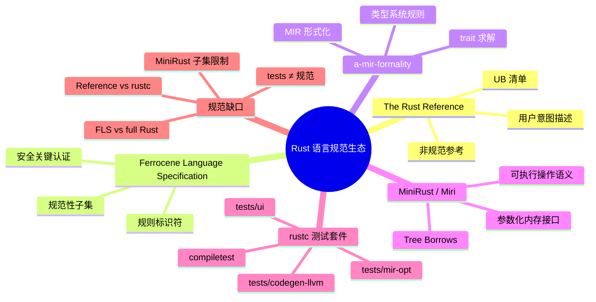

# Rust 语言规范生态总览

**EN**: Rust Language Specification Ecosystem Overview
**Summary**: Maps the layered Rust specification ecosystem—The Rust Reference, Ferrocene Language Specification, a-mir-formality, MiniRust/Miri, and the rustc test suite—into a single traceability framework.

> **Rust 版本**: 1.97.0+ (Edition 2024)
> **Bloom 层级**: L4-L5
> **权威来源**: 本文件为 `concept/` 权威页。
> **关联 L3 页**: [Unsafe Rust](../../03_advanced/02_unsafe/01_unsafe.md)

---

## 1. 规范谱系中的五个坐标

Rust 目前没有单一“圣经式”规范，而是由多个互补文档/工件共同定义语言含义。每个坐标回答不同问题：

| 坐标 | 回答的问题 | 当前角色 | 关键入口 |
|---|---|---|---|
| **The Rust Reference** | “Rust 应该怎么工作？” | 官方主要参考，但[明确声明 not normative](https://doc.rust-lang.org/reference/introduction.html) | <https://doc.rust-lang.org/reference/introduction.html> |
| **Ferrocene Language Specification (FLS)** | “安全关键子集被规范地禁止/允许什么？” | 已捐赠给 Rust Project 的规范性语言规范，带规则标识符与限制子集 | <https://spec.ferrocene.dev/> |
| **a-mir-formality** | “类型系统、trait 求解、借用检查的形式化规则长什么样？” | Rust 官方的 MIR/类型系统形式化模型 | <https://rust-lang.github.io/a-mir-formality/> |
| **MiniRust / Miri** | “如果按某一组规则执行，程序会触发什么 UB？” | 可执行操作语义与动态 UB 检测 | <https://github.com/minirust/minirust> · <https://github.com/rust-lang/miri> |
| **rustc 测试套件** | “编译器实际接受/拒绝哪些程序？” | 规范一致性证据库，非规范本身 | <https://github.com/rust-lang/rust/tree/master/tests> |

> **核心关系**：Reference 描述意图，FLS 在认证子集上增加规范性约束，a-mir-formality 与 MiniRust 提供形式化/可执行语义，rustc tests 提供经验证据。五者之间的不一致，正是“规范缺口”的精确位置。

---

## 2. 分层模型：从用户指南到可执行证据

```text
L1 用户参考        The Rust Programming Language / The Rust Reference
      │
      ▼
L2 技术规范        Ferrocene Language Specification（规则标识符 + 限制子集）
      │                    │
      ▼                    ▼
L3 形式化规约      a-mir-formality（类型系统、trait 求解、借用检查）
      │
      ▼
L4 可执行规约      MiniRust（抽象机 + 参数化内存接口）→ Miri（实现）
      │
      ▼
L5 经验证据        rustc tests（ui / mir-opt / codegen-llvm / compiletest）
```

工程决策时应按风险层级选择证据：

- 普通应用开发：Reference + `rustc` 即可。
- 安全关键/认证项目：FLS 子集 + Reference + 认证报告（[Ferrocene Public Docs](https://public-docs.ferrocene.dev/main/qualification/report/index.html)）。
- 形式化验证/替代实现：a-mir-formality + MiniRust/Miri + 相关测试。
- 编译器开发/ nightly 特性：rustc tests 是事实标准，但需意识到 `--bless` 会改写期望输出。

---

## 3. 来源对齐表

| 主题 | 权威来源 | URL | 在规范谱系中的位置 |
|---|---|---|---|
| 官方规范工作启动 | RFC 3355 — The Rust Specification | <https://rust-lang.github.io/rfcs/3355-rust-spec.html> | L2 技术规范的路线图 |
| 实验性规范 2026 目标 | Rust Project Goals 2026 | <https://rust-lang.github.io/rust-project-goals/2026/experimental-language-specification.html> | L1→L2 的演进计划 |
| FLS 上游化目标 | Rust Project Goals 2025H1 | <https://rust-lang.github.io/rust-project-goals/2025h1/spec-fls-publish.html> | L2 进入 rust-lang 基础设施 |
| 跟踪 issue | rust-lang/rust #113527 | <https://github.com/rust-lang/rust/issues/113527> | 进度与依赖 PR |
| 非规范参考 | The Rust Reference | <https://doc.rust-lang.org/reference/introduction.html> | L1 用户参考 |
| 规范性安全关键规范 | Ferrocene Language Specification | <https://spec.ferrocene.dev/> | L2 技术规范 |
| 类型系统形式化 | a-mir-formality | <https://github.com/rust-lang/a-mir-formality> | L3 形式化规约 |
| 可执行操作语义 | MiniRust | <https://github.com/minirust/minirust> | L4 可执行规约 |
| UB 动态检测 | Miri | <https://github.com/rust-lang/miri> | L4 的工具实现 |
| 操作语义共识 | Unsafe Code Guidelines | <https://rust-lang.github.io/unsafe-code-guidelines/> | L1-L2 与 L3-L4 之间的桥梁 |
| 测试框架 | rustc-dev-guide — Compiletest | <https://rustc-dev-guide.rust-lang.org/tests/compiletest.html> | L5 证据方法论 |

---

## 4. 反命题与边界

### 4.1 常见过度概括

- ❌ “The Rust Reference 就是 Rust 规范。” → ✅ Reference 自身声明非规范；它是意图描述，不是最终裁决。
- ❌ “FLS 覆盖了全部 Rust。” → ✅ FLS 目前聚焦 Ferrocene 认证子集（core + 部分 alloc），并带有明确限制（如 `No unsafe`）。
- ❌ “MiniRust/Miri 通过即代表符合规范。” → ✅ Miri 是单路径解释执行，只检查实际执行到的分支；且 MiniRust 仍只覆盖核心子集。
- ❌ “rustc tests 就是规范。” → ✅ 测试是“实现实际接受什么”的证据，不能替代对“应当接受什么”的规范陈述。
- ❌ “a-mir-formality 已经完成。” → ✅ 截至 2026 年，核心类型系统与 trait solver 仍在推进，unsafe 动态语义尚未覆盖。

### 4.2 工程边界

- **规范优先 vs 实现优先**：Rust 社区当前倾向“实现优先”——当 Reference/FLS 与 `rustc` 不一致时，通常先修复文档；但 Ferrocene 等认证场景要求文档具有约束力，这正是 FLS 的价值。
- **nightly 与 stable 的鸿沟**：规范工作优先 stable 特性；nightly 特性可能未进入任何规范文档。
- **unsafe 语义未完全形式化**：Stacked/Tree Borrows 提供了别名模型，但完整 unsafe 语义仍需与 LLVM ABI、平台调用约定对齐。

---

## 5. 操作性定义与判定程序（2026-10-13 补充）

**定义（语言规范 / language specification）**：一份文档 D 对语言 L 是**规范性（normative）**的，当且仅当存在判定程序：对任意程序 P 与主张 c（“P 在 L 中合法/非法，非法时产生诊断 X”），D 中存在条款 r 使 c 可机械归约到 r，且 r 有稳定标识符与版本锁定。否则 D 是**描述性（descriptive）**参考。

**判定程序（对 Rust 规范生态的四个判定问题）**：

1. 该文档是否自我声明 normative？（Reference：否；FLS：是，但带保留条款）
2. 条款是否有稳定标识符？（FLS：Ada 风格章节段落编号，如 `19:11`；Reference：仅章节标题）
3. 规则是否可机械执行？（a-mir-formality：judgment 函数输出 ProofTree；MiniRust：抽象机规则；rustc tests：期望快照比对）
4. 是否有版本锁定？（FLS 绑定 Edition + rustc 版本；Reference 有版本化 URL）

五坐标按此判定程序的定位：Reference = 描述性；FLS = 规范性（认证范围内）；a-mir-formality / MiniRust = 可执行形式化；rustc tests = 经验证据。

**术语对照（跨文档同义词陷阱）**：

| 本文术语 | Reference 用语 | FLS 用语 | 注意 |
|---|---|---|---|
| 未定义行为 (UB) | behavior considered undefined | undefined behavior（附录 C 枚举） | FLS 1.1.1:13 明确**不规定 UB 的效果**，只枚举触发点 |
| unsafe 操作 | unsafe operations（分散各章） | unsafe operation（19:3–19:9 封闭枚举） | FLS 是封闭列表；Reference 是开放清单 |
| 借用检查 | borrow check | “The mechanics of the borrow checker are outside the scope of the FLS”（changelog 反复出现） | FLS 规范借用**合法性**，不规范检查**算法** |
| 实现定义行为 | implementation defined | 归入“not required to detect”条款（1.1.1:7） | 认证审计须逐条映射 |

## 6. 反例与规范缺口实例（均经 rustc 1.99.0 实测）

**反例 A：同一程序在两个 Edition 下合法性不同**——“Rust 的语言规则”不是单一文本，而是 Edition 版本化函数：

```rust,compile_fail
// Edition 2021：编译通过（仅 dead_code 类警告）
// Edition 2024：error[E0133]: use of mutable static is unsafe and requires unsafe block
static mut COUNTER: i32 = 0;
fn main() {
    COUNTER += 1;
    println!("{COUNTER}");
}
```

rustc 1.99.0 实测：`--edition 2021` 通过；`--edition 2024` 产生 2 个 E0133 硬错误。任何不带 Edition 口径的“规范主张”都是不完整的。

**反例 B：FLS 的自指保留条款**（规范缺口的一手证据）。FLS 1.1:1 原文：

> “It documents the current understanding for the purposes of compiler validation. As such, given any doubt, it prefers documenting behavior of rustc over claiming correctness as a specification.”

即：FLS 自称 normative，但在与 rustc 存疑时以 rustc 行为为准——规范性让位于实现一致性。这是“实现优先 vs 规范优先”张力的权威文本证据（<https://spec.ferrocene.dev/general.html>）。

**反例 C：模型与实现的分歧记录**。a-mir-formality 与 MiniRust 已记录分歧：MiniRust 用 `AddrOf` 操作 + `PtrType` 决定取引用种类，a-mir-formality 增设带 lifetime 的 `Ref` 操作（MiniRust 不携带 lifetime 信息）；a-mir-formality 的 `goto` 允许多后继（非确定性），MiniRust 操作语义则单后继。见 rust-lang/goals#122 进展记录（<https://github.com/rust-lang/rust-project-goals/issues/122>）。

**反例 D：a-mir-formality 现状与常见描述的落差**。2025h2 项目目标明确列出当前局限：“No function body representation / Absence of type checker / No borrow checking model”（<https://goals.rust-lang.org/2025h2/a-mir-formality.html>）——把 a-mir-formality 当作“已完成的类型检查器规范”是过度概括。

## 7. 权威源核实清单（2026-10-13 全部在线核实）

| 事实 | 权威源 |
|---|---|
| Ferrocene 工具链获 TÜV SÜD 认证：ISO 26262 (TCL 3/ASIL D)、IEC 61508 (T3/SIL 3)、IEC 62304 (Class C)；证书 Z10 123030 0001 Rev. 00；2023-10-29 签发，基于 Ferrocene 23.06.0（Rust 1.68） | <https://ferrous-systems.com/blog/officially-qualified-ferrocene> |
| Ferrocene 26.02.0：`core` 认证子集获 ISO 26262 ASIL B + IEC 61508 SIL 2，认证函数从 2,903 增至 5,169 | <https://ferrous-systems.com/blog/ferrocene-26-02-0> |
| FLS 基线：2021 Edition，rustc 1.94（changelog 已跟进 Rust 1.95 语言变更） | <https://spec.ferrocene.dev/general.html> · <https://spec.ferrocene.dev/changelog.html> |
| a-mir-formality 2026 目标（Accepted，types champion: Jack Huey）：作为类型系统规范并与 experimental reference 集成 | <https://goals.rust-lang.org/2026/a-mir-formality.html> |
| RFC 2585（unsafe_block_in_unsafe_fn）：Rust Issue rust-lang/rust#71688；Edition 2024 起 `unsafe_op_in_unsafe_fn` warn-by-default | <https://rust-lang.github.io/rfcs/2585-unsafe-block-in-unsafe-fn.html> |
| arXiv:2504.21312《Annotating and Auditing the Safety Properties of Unsafe Rust》存在性（arXiv API 核实，v2） | <https://arxiv.org/abs/2504.21312> |
| rustc UI 测试实例 `tests/ui/unsafe/edition-2024-unsafe_op_in_unsafe_fn.rs`（含配套 .stderr） | <https://github.com/rust-lang/rust/blob/main/tests/ui/unsafe/edition-2024-unsafe_op_in_unsafe_fn.rs> |

---

## 8. 规范追溯矩阵：一条主张的证据链

以“`unsafe fn` 体内裸解引用原始指针需要显式 `unsafe` 块”这一条语言主张为例，完整证据链如下（可直接复现）：

| 层 | 工件 | 内容 | 定位 |
|---|---|---|---|
| L1 意图 | Edition Guide | “an unsafe function restricts its caller, but its body is safe by default” | <https://doc.rust-lang.org/edition-guide/rust-2024/unsafe-op-in-unsafe-fn.html> |
| L2 规范 | FLS 19:11 | “An unsafe operation shall be used only within an unsafe context.”（`unsafe context` 定义见 19:10） | <https://spec.ferrocene.dev/unsafety.html> |
| L3 形式化 | a-mir-formality | unsafe 操作判定尚未建模（2025h2 目标列出局限） | <https://goals.rust-lang.org/2025h2/a-mir-formality.html> |
| L4 可执行 | Miri | 不检查该 lint（lint 属编译期），只检查执行期 UB | <https://github.com/rust-lang/miri> |
| L5 证据 | rustc UI test | `tests/ui/unsafe/edition-2024-unsafe_op_in_unsafe_fn.rs` + 同名 `.stderr`（warning[E0133] 快照） | <https://github.com/rust-lang/rust/blob/main/tests/ui/unsafe/edition-2024-unsafe_op_in_unsafe_fn.rs> |

**判定结论**：该主张目前只有 L1/L2/L5 三层证据；L3 缺口正是“规范缺口”的具体位置——形式化模型尚未覆盖 Edition 2024 的 unsafety 规则。

## 9. 练习题（判定程序实操）

1. **口径审计题**：某安全关键项目文档写“Rust 保证 `static mut` 访问是 unsafe 的”。按 §5 判定程序改写该主张，使其可判定（提示：必须绑定 Edition 与 rustc 版本，并给出 E0133 的复现命令）。
2. **反例设计题**：构造一个程序，使 FLS（基于 2021 Edition）与 rustc 1.99（`--edition 2024`）对同一源码给出不同诊断。验证：`static mut` 用例（反例 A）是否满足要求？还有哪条 Edition 2024 变更（如 `gen` 关键字、`unsafe_op_in_unsafe_fn`）可作候选？
3. **追溯题**：为“orphan rule 禁止 `impl Display for Vec<i32>`”补全 §8 式追溯矩阵的 L1/L2/L5 三层（L1：Reference items/implementations.html#orphan-rules；L5：rustc E0117 诊断文本）。

---

## 10. 与其他概念的关系

- [MiniRust 操作语义](../03_operational_semantics/10_minirust.md) — 可执行规范的核心抽象。
- [RustBelt：分离逻辑基础](../02_separation_logic/01_rustbelt.md) — 所有权与借用的形式化证明。
- [验证工具链选型](../04_model_checking/01_verification_toolchain.md) — 规范与 Kani / Verus / Creusot 等工具的衔接。
- [编译器测试](../../06_ecosystem/00_toolchain/13_compiler_testing.md) — rustc 测试框架与 `compiletest` 细节。
- [rustc driver 与 Stable MIR](../../06_ecosystem/00_toolchain/10_rustc_driver_and_stable_mir.md) — 把 rustc 当库用，提取规范证据。

---

## 🧭 思维导图（Mindmap）



---

## 国际权威来源（P1/P2 补充）

- [RustBelt: Securing the Foundations of the Rust Programming Language (POPL 2018)](https://dl.acm.org/doi/10.1145/3158154)
- [Stacked Borrows: An Aliasing Model for Rust (POPL 2020)](https://dl.acm.org/doi/10.1145/3371109)
- [Our Vision for the Rust Specification](https://blog.rust-lang.org/inside-rust/2023/11/15/spec-vision.html)
