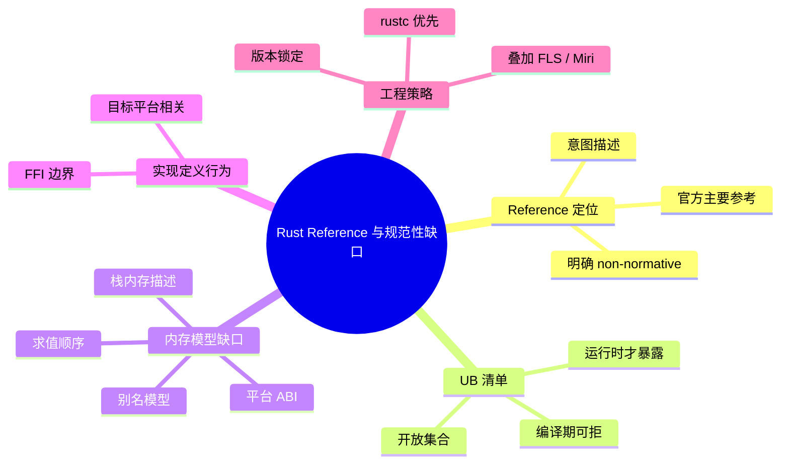

# Rust Reference 与规范性缺口

**EN**: The Rust Reference and the Normative Gap
**Summary**: Explains why The Rust Reference is the official but non-normative reference, and maps its known gaps around undefined behavior, the memory model, and implementation-defined behavior.

> **Rust 版本**: 1.97.0+ (Edition 2024)
> **Bloom 层级**: L3-L4
> **权威来源**: 本文件为 `concept/` 权威页。

---

## 1. Reference 的非规范性声明

[The Rust Reference](https://doc.rust-lang.org/reference/introduction.html) 开篇即声明：

> “This book is not normative. It may include details that are not precisely consistent with the current implementation of rustc, and it may lack details of the behavior of the current implementation of rustc.”

这意味着：

- Reference 是**意图描述**与**教学文档**，不是最终裁决。
- 当 Reference 与 `rustc` 行为冲突时，通常以 `rustc` 为准（“实现优先”）。
- 安全关键/认证项目不能仅依赖 Reference 作为合规证据。

RFC 3355 启动的官方规范工作，目标正是把 Reference 的意图逐步转化为可评审、可版本化的规范文本（[Rust Project Goals 2026 — Experimental Language Specification](https://rust-lang.github.io/rust-project-goals/2026/experimental-language-specification.html)）。

---

## 2. UB 清单与灰色地带

Reference 的 [Behavior Considered Undefined](https://doc.rust-lang.org/reference/behavior-considered-undefined.html) 列出了已知的 UB 类别，例如：

- 数据竞争
- 使用悬垂/未对齐/无效的引用或指针
- 读取未初始化内存
- 破坏 `Pin` 不变式
- 调用 ABI 不匹配的函数

但这些列表是**开放集合**：某些边缘行为（如特定别名模式在 Stacked/Tree Borrows 下的判定）尚未被 Reference 完全吸收。Unsafe Code Guidelines (UCG) 工作组持续把学术共识（如 Tree Borrows）反馈到 Reference 与 rustc 实现中。

```rust,compile_fail
fn main() {
    let mut x = 0;
    let r1 = &mut x;
    let r2 = &mut x; // ❌ Reference 已列 UB：同一位置的两个可变引用
    println!("{} {}", r1, r2);
}
```

> 编译器在这里直接拒绝；但 UB 清单中大量条目（如数据竞争、use-after-free）要到运行时（Runtime）才暴露，因此不能仅凭“通过编译”推断“符合 Reference”。

---

## 3. “非规范性”的操作性定义与判定程序

**定义**：文档 D 对语言 L **非规范性（non-normative）**，当且仅当存在至少一个程序 P 与主张 c，使得 (i) c 关于 P 的合法性/诊断无法机械归约到 D 的任何条款，或 (ii) D 的条款与 rustc 实际诊断冲突时 D 不构成裁决依据。Reference 开篇声明满足 (i)+(ii) 两个条件，因此是教科书式非规范文档。

**判定程序（把任意 Reference 主张转成可判定形式）**：

1. 定位条款：给出带版本号的 URL（如 `https://doc.rust-lang.org/1.97.0/reference/...`）。
2. 绑定口径：Edition + `rustc --version` 输出。
3. 构造最小复现：`rustc --edition N file.rs` 的退出码与错误码（E0xxx）。
4. 交叉验证：若主张涉及运行时 UB，追加 Miri 运行（编译通过 ≠ 无 UB）。
5. 记录分歧：若第 3/4 步结果与条款文本不一致，向 rust-lang/reference 提 issue，并在工程文档中标注“实现优先”。

## 4. 反例与边界案例（均经 rustc 1.99.0 实测）

### 4.1 反例 A：借用规则不是词法规则——NLL 边界

Reference 教学语言常说“可变借用期间不能再借用”。词法直觉会误判下面这个**合法**程序：

```rust
fn main() {
    let mut x = 0;
    let r1 = &mut x;
    *r1 += 1;          // r1 最后一次使用（r1 在此之后死亡）
    let r2 = &mut x;   // ✅ 合法：NLL 按活跃性(liveness)判定，不按词法作用域
    *r2 += 2;
    println!("{x}");   // 输出 3
}
```

rustc 1.99.0 实测通过并输出 `3`。而把 `println!` 移到 `let r2` 之前引用 `r1` 则触发 E0499（见 §4）。**边界结论**：Reference 的自然语言“借用规则”与 rustc 判定算法（NLL/Polonius 活跃性约束）之间存在精度缺口；合规判定必须按错误码复现，不能按散文直觉。

### 4.2 反例 B：编译通过但运行时 UB——Reference 静态条款覆盖不到

```rust,ignore
// 编译通过（rustc 1.99.0 无错误无警告）；cargo miri run 报错：
// "Undefined Behavior: dereferencing a dangling pointer"（use-after-free）
fn main() {
    let v: Vec<i32> = Vec::new();
    let p = v.as_ptr();
    drop(v);                      // 堆内存已释放
    unsafe { println!("{}", *p); } // 悬垂解引用：Reference UB 清单条目
}
```

该例证明：Reference UB 清单的多数条目（悬垂指针、未初始化读、数据竞争）是**动态条款**，编译期诊断为零；“通过编译”对符合性没有任何证明力。Miri 的判定消息格式见 <https://github.com/rust-lang/miri>。

### 4.3 反例 C：同一 UB 在不同 Edition 下静态可拒/不可拒

```rust,compile_fail
// Edition 2021：通过（仅警告）。Edition 2024：error[E0133] ×2
static mut COUNTER: i32 = 0;
fn main() {
    COUNTER += 1;
    println!("{COUNTER}");
}
```

rustc 1.99.0 实测：`--edition 2024` 报 2 个 E0133（“use of mutable static is unsafe and requires unsafe block”）；`--edition 2021` 仅 dead_code 类警告通过。Reference 的 UB 清单本身不随 Edition 变化，但**静态可诊断性**随 Edition 变化——引用 Reference 时必须同时声明 Edition。

### 4.4 反例 D：unsafe fn 契约无法完全静态化

```rust,compile_fail
// error[E0515]: cannot return reference to local variable `local`
unsafe fn bad<'a>(x: i32) -> &'a i32 {
    let local = x;
    &local
}
fn main() {}
```

E0515 说明：即使函数标了 `unsafe`（把契约责任转移给调用方），**返回类型里的 lifetime 仍受静态检查**——`'a` 不能绑定到局部变量。契约外移是有边界的：类型层约束不可外移，只有“指针有效性、对齐、别名”类前提可以外移。这是 Reference “unsafe 不变式”章节未明说、但 rustc 强制的边界。

## 5. rustc UI 测试实例（规范缺口的经验证据）

| 实例（rust-lang/rust, main 分支） | 证明的主张 |
|---|---|
| `tests/ui/borrowck/assign-imm-local-twice.rs` | 双重可变借用被拒（E0499 家族基线） |
| `tests/ui/unsafe/edition-2024-unsafe_op_in_unsafe_fn.rs` + `.stderr` | Edition 2024 下 `unsafe_op_in_unsafe_fn` 为 warn-by-default，快照为 `warning[E0133]` |
| `tests/ui/unsafe/unsafe-fn-called-from-safe.rs` | safe 上下文调用 `unsafe fn` 被拒 |
| `tests/ui/unsafe/unsafe-not-inherited.rs` | `unsafe` 不沿闭包/嵌套 fn 自动继承 |

对应本地复现（rustc 1.99.0 实测，`#[deny(unsafe_op_in_unsafe_fn)]` 下 Edition 2021 也产生 E0133 硬错误）：

```rust,compile_fail
#[deny(unsafe_op_in_unsafe_fn)]
unsafe fn deref(p: *const i32) -> i32 {
    *p // error[E0133]: dereference of raw pointer is unsafe and requires unsafe block
}
fn main() {}
```

## 6. 内存模型与实现定义行为

Reference 的内存模型章节主要描述：

- 变量的表示、对齐与布局
- 引用与裸指针的有效值约束
- `unsafe` 块中程序员必须保持的不变式

但以下领域仍存在规范缺口：

| 领域 | Reference 状态 | 现实来源 | 风险 |
|---|---|---|---|
| 别名模型 | 描述借用规则，未精确到 Stacked/Tree Borrows | UCG / Miri / MiniRust | 同一代码在 Miri 新旧模型下结论不同 |
| 求值顺序 | 部分表达式未指定求值顺序 | `rustc` 实际行为 | 换编译器版本可能漂移 |
| 整数溢出 debug/release | 明确（release 下回绕） | Reference 已覆盖 | 低 |
| 栈内存描述 | 已知遗漏/bug（如 rust-lang/reference #1489） | 社区 issue | 依赖栈地址的 unsafe 代码不可移植 |
| 平台 ABI | 实现定义行为 | 目标平台文档 | FFI 跨平台差异 |

---

## 7. 版本化 URL 与引用稳定性

Reference 每个稳定版本都有带版本号的 URL，可用于锁定审计基线：

```rust
//! 审计基线示例：锁定 Rust 1.97.0 的 Reference URL
//! https://doc.rust-lang.org/1.97.0/reference/behavior-considered-undefined.html

fn main() {}
```

在合规文档中引用带版本号的 URL，可以避免“最新版 Reference 已修改相关条款”导致的基线失效。

---

## 8. 反命题与边界

### 8.1 常见过度概括

- ❌ “Reference 说了的才合法，没说的就不合法。” → ✅ Reference 是不完整的意图文档；大量合法程序依赖未文档化的实现行为。
- ❌ “Reference 的 UB 列表是穷尽的。” → ✅ UCG 与 Miri 仍在发现新的边缘 UB 模式；列表会随版本扩展。
- ❌ “编译通过 = 符合 Reference。” → ✅ Reference 描述的许多规则是动态语义，编译器无法在编译期全部检查。
- ❌ “Reference bug 会立即修复。” → ✅ 自然语言规范 bug 的修复需要社区共识，可能慢于编译器 bug 修复。

### 8.2 工程边界

- **不要以 Reference 作为安全关键项目的唯一合规依据**；应叠加 FLS、测试证据与形式化工具结果。
- **遇到 Reference 与 `rustc` 不一致时**，优先在 rust-lang/reference 提 issue；在 issue 解决前，以 `rustc` 实际行为作为工程事实标准。
- **版本锁定**：审计或认证时应引用带版本号的 Reference URL，并记录检查时的 `rustc --version`。

---

## 9. 国际权威来源

- [The Rust Reference — Introduction](https://doc.rust-lang.org/reference/introduction.html)
- [The Rust Reference — Behavior Considered Undefined](https://doc.rust-lang.org/reference/behavior-considered-undefined.html)
- [Unsafe Code Guidelines](https://rust-lang.github.io/unsafe-code-guidelines/)
- [rust-lang/reference issues](https://github.com/rust-lang/reference/issues)
- [RFC 3355 — The Rust Specification](https://rust-lang.github.io/rfcs/3355-rust-spec.html)
- [rustc UI 测试：tests/ui/unsafe/edition-2024-unsafe_op_in_unsafe_fn.rs](https://github.com/rust-lang/rust/blob/main/tests/ui/unsafe/edition-2024-unsafe_op_in_unsafe_fn.rs)
- [rustc UI 测试目录：tests/ui/borrowck/](https://github.com/rust-lang/rust/tree/main/tests/ui/borrowck)
- [Edition Guide — unsafe_op_in_unsafe_fn (Rust 2024)](https://doc.rust-lang.org/edition-guide/rust-2024/unsafe-op-in-unsafe-fn.html)
- [Miri（动态 UB 判定工具）](https://github.com/rust-lang/miri)
- [Ralf Jung — Tree Borrows](https://www.ralfj.de/blog/2023/06/02/tree-borrows.html)

---

## 10. 与其他概念的关系

- [可执行规范：MiniRust 与 Miri](03_executable_specification_minirust.md) — 把 Reference 的 UB 清单动态化。
- [Tree Borrows 深度解析](../01_ownership_logic/05_tree_borrows_deep_dive.md) — 别名模型的技术细节。
- [Behavior Considered Undefined](../01_ownership_logic/06_behavior_considered_undefined.md) — UB 清单的专门讨论。
- [内存模型](../../03_advanced/02_unsafe/06_memory_model.md) — Rust 内存模型的权威概念页。

---

## 🧭 思维导图（Mindmap）



---

## 国际权威来源（P1/P2 补充）

- [RustBelt: Securing the Foundations of the Rust Programming Language (POPL 2018)](https://dl.acm.org/doi/10.1145/3158154)
- [Stacked Borrows: An Aliasing Model for Rust (POPL 2020)](https://dl.acm.org/doi/10.1145/3371109)
- [Our Vision for the Rust Specification](https://blog.rust-lang.org/inside-rust/2023/11/15/spec-vision.html)
