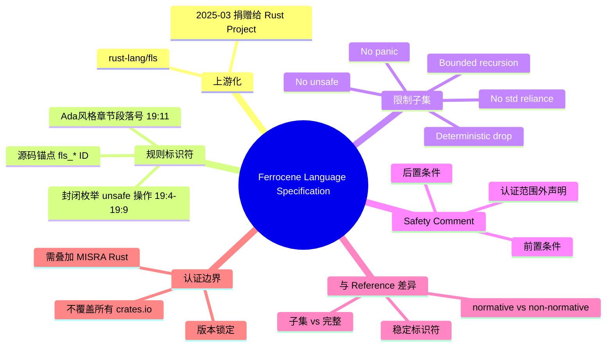

# Ferrocene 语言规范（FLS）

**EN**: Ferrocene Language Specification (FLS)
**Summary**: Describes the structure, rule identifiers, restricted subsets, and differences between the Ferrocene Language Specification and The Rust Reference, including its upstream donation to the Rust Project.

> **Rust 版本**: 1.97.0+ (Edition 2024)
> **Ferrocene 版本**: 26.02.0（基于 rustc 1.92）
> **Bloom 层级**: L4-L5
> **权威来源**: 本文件为 `concept/` 权威页。
> **关联 L3 页**: [Unsafe Rust](../../03_advanced/02_unsafe/01_unsafe.md)

---

## 1. FLS 的上游化与定位

[Ferrocene Language Specification](https://spec.ferrocene.dev/) 最初由 Ferrous Systems / AdaCore 为 Ferrocene 认证工具链编写，2025 年 3 月捐赠给 Rust Project（[Rust Project Goals 2025H1 — Publish first rust-lang-owned release of "FLS"](https://rust-lang.github.io/rust-project-goals/2025h1/spec-fls-publish.html)）。其定位是：

- **规范性文档**：与 Reference 的 non-normative 声明相反，FLS 的条款在安全关键认证范围内具有约束力。
- **子集规范**：明确列出 Ferrocene 支持的语言子集与限制。
- **规则标识符**：每条规则都有稳定标识符（如 `FLS-C-0001`），便于审计追踪与工具链检查。

源码仓库位于 [rust-lang/fls](https://github.com/rust-lang/fls)，认证证据链见 [Ferrocene Public Docs / Qualification Report](https://public-docs.ferrocene.dev/main/qualification/report/index.html)。

---

## 2. 规则标识符与文档结构

FLS 采用 **Ada Reference Manual 风格的章节-段落编号**（FLS 1:1 明确声明其结构承袭 Ada RM），而非“FLS-C-0001”式自定义前缀。每条规则（Legality Rule / Syntax / Runtime Rule）在渲染页与源码 `src/*.rst` 中都有 Ada 式定位号与内部锚点 ID（源码中形如 `:dp:`fls_8kqo952gjhaf``）：

```text
19:11   An unsafe operation shall be used only within an unsafe context.
  └── 19   = 章（Unsafety）
  └── 11   = 章内段落号（Ada RM 风格）
  └── 源码锚点示例：fls_ybnpe7ppq1vh（rust-lang/fls/src/unsafety.rst）
```

实例（FLS 第 19 章 “Unsafety”，2026-10-13 从 spec.ferrocene.dev 与 rust-lang/fls 源码核实）：

| 条款号 | 内容（原文摘录） |
|---|---|
| 19:2 | “An unsafe operation is an operation that may result in undefined behavior that is not diagnosed as a static error.” |
| 19:4–19:9 | 封闭枚举 unsafe 操作：解引用裸指针、读/写 external static、读/写 mutable static、读 union 字段（赋值除外）、调用 unsafe fn、调用 `core::arch::asm` |
| 19:10 | “An unsafe context is either an unsafe block or an unsafe function.” |
| 19:11 | “An unsafe operation shall be used only within an unsafe context.” |

这种 Ada 式编号使认证审计能够精确引用“哪一条规则被违反/满足”，且段落删除/新增在 changelog 中以锚点 ID 追踪（如 1.93 变更记录 “Removed paragraphs: Paragraph fls_ooOYxhVh8hZo”）。

---

## 3. 限制子集

FLS 为降低认证成本，对 Ferrocene 认证子集施加了明确限制。典型限制类别包括：

- **No unsafe**：认证代码不得使用 `unsafe` 块或 `unsafe fn`。
- **No panic**：程序必须被证明不会 panic（通过静态分析或运行时检查）。
- **Bounded recursion**：递归必须有可证明的上界。
- **Deterministic drop**：资源释放顺序必须可预测。
- **No std reliance**：仅依赖已认证的 `core`/`alloc` 子集，避免未经验证的 `std` API。

这些限制不是 Rust 语言本身的限制，而是**认证项目与 FLS 之间的合约**。超出子集的代码需要额外的安全论证与证据。

```rust,compile_fail
#![forbid(unsafe_code)]

fn main() {
    // ❌ 违反 Ferrocene 认证子集限制（对应 FLS 19 章 unsafety 规则的子集化裁剪）
    unsafe {
        println!("forbidden");
    }
}
```

> 上述代码会被 `rustc` 直接拒绝，因为 `#![forbid(unsafe_code)]` 是语言级属性；FLS 的子集限制则通过项目策略、静态检查或审计流程强制执行。

---

### 3.1 子集限制的规范落点（源码核实）

FLS 源码 `src/` 共 30 个 `.rst` 文件、22 章 + 附录（含附录 C “List of undefined behavior”，本身标注 `informational-page`——UB 清单在 FLS 中也是**信息性**而非规范性内容）。限制子集的“No unsafe/No panic”等条款不在 FLS 语言规则里，而在 Ferrocene 认证文档（Qualification Report）中；FLS 只定义语言，认证合约定义裁剪。混淆两者会把“认证合约限制”误读为“语言规则”。

## 4. 规范性判定程序与认证事实基线（2026-10-13 核实）

**FLS 规范性的操作性定义**：对 Ferrocene 认证范围内的程序 P 与主张 c，c 可机械归约到 FLS 某条带 Ada 式编号的 Legality/Syntax/Runtime Rule，且该归约结果被 Ferrocene 认证报告（Qualification Report）作为工具链验证证据引用。范围外（1.1.1:8 列举项，含 UB 的效果、错误消息文本、代码尺寸）不构成规范主张。

**判定程序（审计一条代码主张是否落在 FLS 内）**：

1. 查 FLS 1.1.1 “Extent”：该行为是否在“specifies / does not specify”清单内（UB 效果、错误消息形式明确**不在**范围内）。
2. 定位条款：章:段落号（如 `19:11`）+ 源码锚点（`fls_*` ID）。
3. 核对 Edition/rustc 基线：FLS 1.1:1 声明基线为 **2021 Edition + rustc 1.94**（changelog 跟进到 Rust 1.95 语言变更）。基线外的特性（如 Edition 2024 变更）不在当前 FLS 规范性范围内。
4. 存疑裁决：按 1.1:1 保留条款——“given any doubt, it prefers documenting behavior of rustc over claiming correctness as a specification”。

**认证事实基线（权威源核实，纠正常见误传）**：

| 事实 | 细节 | 源 |
|---|---|---|
| 工具链认证 | Ferrocene 23.06.0（基于 Rust 1.68）获 TÜV SÜD 认证：ISO 26262 TCL 3/ASIL D、IEC 61508 T3/SIL 3、IEC 62304 Class C；证书 Z10 123030 0001 Rev. 00，2023-10-29 签发 | <https://ferrous-systems.com/blog/officially-qualified-ferrocene> |
| `core` 子集认证 | Ferrocene 26.02.0：认证 `core` 函数从 2,903 增至 5,169，获 ISO 26262 ASIL B + IEC 61508 SIL 2 | <https://ferrous-systems.com/blog/ferrocene-26-02-0> |
| 更高目标 | 支持客户认证至 IEC 61508 SIL 4 与 DO-178C DAL C | <https://ferrous-systems.com/blog/ferrocene-26-05-0> |

> 常见误传纠正：任务背景常写“Ferrocene 2024 年获 ASIL D 认证”——权威源显示工具链 ASIL D 资质**签发于 2023-10-29**（Ferrocene 23.06.0）；2024–2026 的增量是 `core` 库子集的 ASIL B/SIL 2 认证与更高 SIL/DAL 支持。引用时必须区分“工具链资质”与“库子集认证”两条证据链。

## 5. 反例与边界案例（rustc 1.99.0 实测）

### 5.1 反例 A：FLS 19:7 的 union 条款——“读 union 字段”是封闭枚举成员

```rust
union U { i: u32, f: f32 }
fn main() {
    let u = U { f: 1.0 };
    unsafe { println!("{}", u.i); } // FLS 19:7：读 union 字段（赋值除外）是 unsafe operation
}
```

rustc 1.99.0 实测通过（输出 `1065353216`，即 1.0f32 的位模式按 u32 读出）。判定演示：该程序合法，因为 unsafe 操作出现在 unsafe context（19:11）；去掉 `unsafe` 块则 rustc 直接拒绝。**边界**：FLS 19:4–19:9 是**封闭枚举**——Reference 的 UB 清单是开放集合，FLS 把“哪些操作需要 unsafe context”封闭化，这正是其规范性价值；但 UB 的**效果**仍被 1.1.1:13 排除在规范之外。

### 5.2 反例 B：FLS 基线（2021 Edition）与 Edition 2024 的错位

`static mut COUNTER` 用例（见 01 号页 §4.3）：FLS 当前基线是 2021 Edition + rustc 1.94，`unsafe_op_in_unsafe_fn` 在 FLS 基线下只是 lint（RFC 2585 路径），而 rustc 1.99 `--edition 2024` 已把它升为 warn-by-default 且 `#[deny]` 下产生 E0133 硬错误。**审计含义**：引用 FLS 条款判定 Edition 2024 代码是范围外使用——FLS changelog 逐版本记录这类落差（“Lints are outside the scope of the FLS”反复出现）。

### 5.3 边界案例 C：`forbid(unsafe_code)` ≠ FLS 子集合规

`#![forbid(unsafe_code)]` 只拒绝 `unsafe` 块/`unsafe fn`/`unsafe impl` 语法（rustc 1.99 实测：`unsafe {}` 产生 “usage of an `unsafe` block” 硬错误），但 FLS 认证子集还要求无 panic、有界递归、确定性 drop——这些**没有任何 rustc 属性可以强制**。反例：

```rust
#![forbid(unsafe_code)]
fn bounded(i: u32) -> u32 {
    if i == 0 { 0 } else { bounded(i - 1) + 1 } // 无 unsafe，但递归上界需另行论证
}
fn main() {
    let v: Vec<u32> = Vec::new();
    println!("{}", v[0]); // panic（index out of bounds）：无 unsafe 也违反 “No panic” 子集限制
}
```

编译通过、无 unsafe，但运行时 panic——说明 FLS 子集限制是**合约束**，`forbid(unsafe_code)` 只是其中一条的机械代理。

## 6. FLS 与 Reference 差异的条款级实例

| 主张 | Reference 表述 | FLS 条款 | 差异性质 |
|---|---|---|---|
| unsafe 操作集合 | 开放清单，分散各章 | 19:4–19:9 封闭枚举 | FLS 封闭化 |
| UB 效果 | 描述风险与示例 | 1.1.1:13 明确不规定 | Reference 更宽但更模糊 |
| 借用检查算法 | NLL 描述 + 诊断文本 | changelog：“mechanics of the borrow checker are outside the scope” | 两者都不规范算法 |
| 错误消息 | 无约束 | 1.1.1:12 明确不规定消息形式 | 一致：均不约束 wording |
| 存疑裁决 | 实现优先（惯例） | 1.1:1 明文写入文档 | FLS 把惯例成文化 |

## 7. FLS 风格 Safety Comment

即使子集禁止 `unsafe`，FLS 仍要求对任何潜在不安全假设（如外部 FFI、硬件寄存器访问）提供 Safety Comment。典型格式如下：

```rust,ignore
/// # Safety
/// - `ptr` must be non-null, properly aligned, and valid for reads of `T`.
/// - The caller must ensure no data race occurs during the read.
/// - This function is outside the Ferrocene certified subset;
///   additional qualification evidence is required.
pub unsafe fn fls_style_read<T>(ptr: *const T) -> T {
    unsafe { ptr.read() }
}
```

> 该示例使用 `rust,ignore`，因为它包含 Miri/nightly 风格假设与 Ferrocene 子集注释，不适合在 stable rustc 1.97 下作为普通 crate 编译。

---

## 8. FLS 与 Reference 的差异（总表）

| 维度 | The Rust Reference | Ferrocene Language Specification |
|---|---|---|
| 规范性 | 明确 non-normative | 在认证范围内 normative |
| 覆盖范围 | 追求完整 Rust | 聚焦认证子集（core + 部分 alloc） |
| 规则标识 | 章节标题/段落 | `FLS-C-0001` 等稳定标识符 |
| unsafe | 描述规则与风险 | 子集可完全禁止 |
| panic | 描述机制 | 子集要求无 panic |
| std | 覆盖完整标准库 | 仅认证选定 API |
| 更新节奏 | 社区驱动 | 与 Ferrocene 发布周期绑定 |

FLS 不会替代 Reference；它把 Reference 中“意图”的部分条款提升为“必须遵守”的认证约束。

---

## 9. 反命题与边界

### 9.1 常见过度概括

- ❌ “Ferrocene 认证工具链 = 任何 crates.io 依赖都认证。” → ✅ 认证范围只覆盖 Ferrocene 验证过的 `rustc`、标准库子集与项目自身代码；第三方依赖需单独评估。
- ❌ “FLS 就是完整 Rust 规范。” → ✅ FLS 当前只覆盖认证所需子集，大量 nightly 特性、宏、部分 std API 不在范围内。
- ❌ “FLS 取代了 Reference。” → ✅ FLS 与 Reference 互补：Reference 描述意图，FLS 在子集上增加规范性约束。
- ❌ “通过 Ferrocene 编译器即自动通过认证。” → ✅ 认证还包括流程、文档、测试覆盖、安全分析等；编译器只是工具链一环。

### 9.2 工程边界

- **子集选择是项目决策**：是否禁止 `unsafe`、是否允许 panic，取决于认证等级（如 ISO 26262 ASIL）。
- **MISRA Rust 互补**：汽车/航空行业常把 FLS 与 [MISRA Rust Guidelines](https://misra.org.uk/) 叠加使用，形成编码规范 + 语言规范的双重约束。
- **FLS 规则会演进**：随着 FLS 上游化，规则编号、限制范围可能调整；认证基线需要版本锁定。

---

## 10. 国际权威来源

- [Ferrocene Language Specification](https://spec.ferrocene.dev/)
- [rust-lang/fls](https://github.com/rust-lang/fls)
- [Ferrocene Public Docs — Qualification Report](https://public-docs.ferrocene.dev/main/qualification/report/index.html)
- [Ferrocene 官方认证公告（TÜV SÜD 证书 Z10 123030 0001 Rev. 00，ASIL D/SIL 3，2023-10-29）](https://ferrous-systems.com/blog/officially-qualified-ferrocene)
- [Ferrocene 26.02.0 发布（core 子集 ASIL B/SIL 2，认证函数 5,169）](https://ferrous-systems.com/blog/ferrocene-26-02-0)
- [FLS Unsafety 章（19:1–19:11 条款原文）](https://spec.ferrocene.dev/unsafety.html)
- [FLS General/Scope 章（规范性保留条款 1.1:1）](https://spec.ferrocene.dev/general.html)
- [FLS 源码 rust-lang/fls/src/unsafety.rst](https://github.com/rust-lang/fls/blob/main/src/unsafety.rst)
- [Ferrocene 官网](https://ferrocene.dev/)
- [MISRA Rust Guidelines](https://misra.org.uk/)
- [Safety-Critical Rust Consortium](https://rustfoundation.org/safety-critical-rust-consortium/)
- [Rust Project Goals 2025H1 — FLS publish](https://rust-lang.github.io/rust-project-goals/2025h1/spec-fls-publish.html)

---

## 11. 与其他概念的关系

- [Rust Reference 与规范性缺口](01_rust_reference_and_normative_gap.md) — Reference 的非规范性与 FLS 的规范性对比。
- [验证工具链选型](../04_model_checking/01_verification_toolchain.md) — 认证项目如何组合 Kani / Verus / Miri。
- [编译器测试](../../06_ecosystem/00_toolchain/13_compiler_testing.md) — 认证证据链中的测试策略。
- [content/safety_critical/07_case_studies/01_case_study_01_ferrocene_certification.md](../../../content/safety_critical/07_case_studies/01_case_study_01_ferrocene_certification.md) — Ferrocene 认证专题案例（应用场景，非概念推导）。

---

## 12. 练习题（FLS 判定程序实操）

1. **条款归约题**：把“`unsafe fn` 内调用另一个 `unsafe fn` 不需要 `unsafe` 块”这一主张归约到 FLS 条款（提示：19:8 是 unsafe 操作，19:10 定义 unsafe context 包含 unsafe function，19:11 要求操作在 context 内）。再对照 rustc 1.99 `--edition 2024` 的 `unsafe_op_in_unsafe_fn` 警告：FLS 判定与 rustc 诊断为何不冲突？（提示：lint 在 FLS 范围外。）
2. **范围审计题**：某客户代码使用 `std::collections::HashMap`。按 §4 判定程序说明它为什么不能直接引用 FLS 规范性条款，以及认证项目应引用哪条证据链（`core` 认证子集清单 + 第三方依赖评估）。
3. **基线漂移题**：FLS 基线是 2021 Edition + rustc 1.94。列出你项目中至少两处 Edition 2024 特性用法，并给出“FLS 范围外”的处置方案（回退到 2021 语义 / 等待 FLS 跟进 / 单独安全论证）。

## 🧭 思维导图（Mindmap）



---

## 国际权威来源（P1 补充）

- [Rust for Embedded Systems: Current State and Open Challenges](https://arxiv.org/abs/2311.05063)
