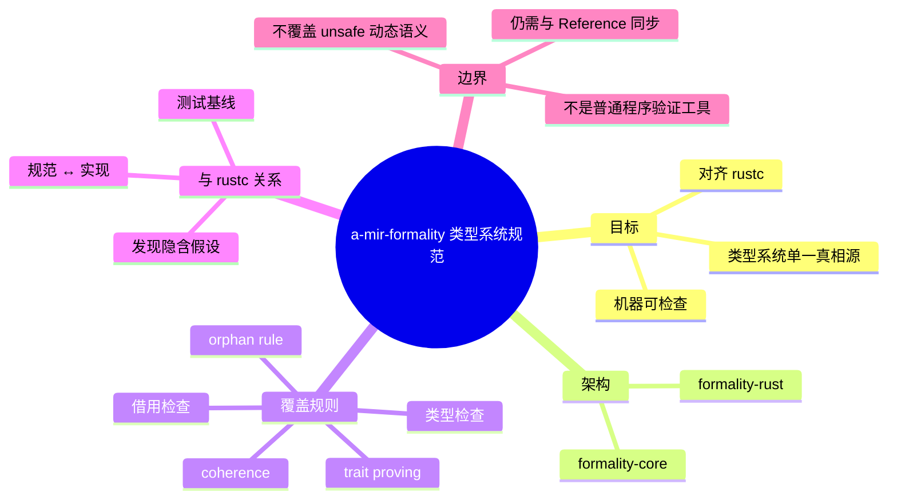

# a-mir-formality：MIR / 类型系统 / trait 求解的形式化模型

**EN**: a-mir-formality: A Formal Model of MIR, Type System, and Trait Solving
**Summary**: Positions a-mir-formality as the Rust project's machine-checkable formalization of MIR, type-checking, borrow-checking, coherence, and trait proving, and clarifies its scope relative to rustc and dynamic semantics.

> **Rust 版本**: 1.97.0+ (Edition 2024)
> **Bloom 层级**: L4-L5
> **权威来源**: 本文件为 `concept/` 权威页。
> **关联 L3 页**: [Unsafe Rust](../../03_advanced/02_unsafe/01_unsafe.md)

---

## 1. 为什么需要类型系统形式化

Rust 的类型系统规则目前分散在三处：

- `rustc` 源码（约 50 万行，隐含假设与实现细节交织）
- The Rust Reference（自然语言，存在歧义）
- RFC 文档（设计意图，非精确规格）

这种分散导致：第三方工具（rust-analyzer、Clippy）、替代实现（gccrs）、形式化验证工具各自对类型系统有独立理解，结果难以比较。

[a-mir-formality](https://github.com/rust-lang/a-mir-formality) 的目标是成为 Rust 类型系统的**单一、机器可检查的形式化规范**，覆盖 MIR 层面的类型检查、借用检查、coherence 与 trait 求解。

---

## 2. 架构：formality-core 与 formality-rust

a-mir-formality 由两个主要部分组成：

| 组件 | 职责 | 技术基础 |
|---|---|---|
| **formality-core** | 通用形式化基础设施：judgment、substitution、unification | 基于逻辑编程/规则引擎风格 |
| **formality-rust** | Rust 专用规则：类型检查、借用检查、trait proving、coherence | 小步操作语义 + 双向类型检查 |

整体流程：

```text
Rust 源代码
    ↓ rustc 前端
MIR
    ↓ 形式化翻译
a-mir-formality (formality-rust)
    ↓ 证明/检查
类型安全定理: ⊢ program → safe
```

[a-mir-formality Book](https://rust-lang.github.io/a-mir-formality/) 详细介绍了 workspace 结构与 judgment functions 的写法。

---

## 3. Judgment Functions 示例

a-mir-formality 使用 judgment function 表达类型规则。以下是用 Rust-like 伪代码展示的“可变引用类型检查”规则：

```rust,ignore
// a-mir-formality-style judgment (pseudocode)
fn type_check(env: &Env, expr: &Expr, expected: &Ty) -> Result<(), TypeError> {
    match expr {
        Expr::Var(x) => {
            let ty = env.lookup(x)?;
            ensure(subtype(ty, expected));
        }
        Expr::Ref(place, Mutability::Mut) => {
            let place_ty = place_ty(env, place)?;
            let ref_ty = Ty::Ref(Box::new(place_ty), Mutability::Mut);
            ensure(subtype(&ref_ty, expected));
            // borrow check produces additional lifetime constraints
        }
        Expr::Call(func, args) => {
            let func_ty = type_check_infer(env, func)?;
            let (param_tys, ret_ty) = func_ty.as_fn()?;
            for (arg, param) in args.iter().zip(param_tys) {
                type_check(env, arg, param)?;
            }
            ensure(subtype(ret_ty, expected));
        }
        // ...
    }
    Ok(())
}
```

> 该代码块使用 `rust,ignore`，因为 a-mir-formality 的真实规则使用专用 DSL/逻辑规则表示，而非可直接编译的 Rust。

---

### 3.1 ProofTree：机器可检查的判定输出

a-mir-formality 的判定不是布尔值而是**证明树**。book 中 trait 求解入口（`prove/` 模块）：

```rust,ignore
// 摘自 a-mir-formality book（formality_rust 章），prove 模块主入口签名
prove_wc(_decls: Program, env: Env, assumptions: Wcs, goal: Wc) => Constraints
```

判定程序含义：给定环境 `env` 与假设集 `assumptions`（where-clauses），对目标 `goal` 递归展开规则；成功返回约束集（可继续归约），失败返回无解——整棵树可 dump 供人审。goals#122 记录 PR #206/#207 引入 “tracking proof trees, making it *much* easier to tell why something is accepted that should not be”，即 ProofTree 的调试价值：模型误接受时能定位到具体规则实例。

对比 rustc：rustc 的 trait 求解（旧 `trait_selection` / 新 next-gen solver）也产出候选证明但**不承诺可审计的规范树**；这正是“实现”与“规范”的又一差异面。

## 4. 覆盖范围：borrow check / coherence / trait proving

a-mir-formality 当前重点覆盖：

- **类型检查**：MIR 层面的表达式、语句、终结符类型规则。
- **借用检查**：与 Polonius/NLL 对齐的生命周期约束。
- **Coherence**：impl 之间不重叠、orphan rule（孤儿规则）。
- **Trait proving**：where-clause 求解、关联类型规范化。

orphan rule 保证：对于 trait `T` 与类型 `Ty`，impl 必须存在“本地类型”锚点（含泛型时要求 local type 出现在 uncovered type parameters 之前），以避免不同 crate 产生冲突 impl。形式化这一规则是 coherence 证明的基础；可执行的正/负实例见 §6.1（rustc 1.99.0 实测 E0117 与通过用例）。

---

## 5. 形式化规范的操作性定义与判定程序

**定义（a-mir-formality 式形式化规范）**：对 Rust 类型系统的一个片段 S，一个形式化模型 M 是 S 的规范，当且仅当：(i) M 的语法层（`grammar/`，`#[term]` 宏生成的 term 类型）能解析 S 的合法输入；(ii) M 的判定系统（`formality-core` 的 judgment/proof 系统，fixed-point 求值）对任意输入产生接受/拒绝结论与可检查的 **ProofTree**；(iii) M 的结论与 rustc 在稳定化测试集上的接受/拒绝一致（差异须逐条裁决：修模型或修实现）。

**判定程序（用 a-mir-formality 验证一条类型系统主张）**：

1. 把主张写成 formality-rust 输入文件（Rust-like dialect，`try_term()` 解析）。
2. 运行 `check_all_crates()`，得到接受/拒绝 + ProofTree。
3. 用同一程序跑 `rustc`，比对接受/拒绝与错误码。
4. 分歧时查 ProofTree 定位模型规则，提交 PR 或在 goals#122 记录裁决。

**当前覆盖状态（2026-10-13 权威源核实，防止过时描述）**：

| 组件 | 状态 | 源 |
|---|---|---|
| trait 求解 / where-clause / 子类型 / outlives（`prove_wc`） | 已建模，持续演进 | <https://rust-lang.github.io/a-mir-formality/formality_rust.html> |
| coherence（含 negative impls） | 2025h1 目标：建模并与新 trait solver 对比 | <https://goals.rust-lang.org/2025h1/formality.html> |
| 函数体表示 | 2025h2 目标：以 MiniRust 程序表示函数体（此前“无函数体”） | <https://goals.rust-lang.org/2025h2/a-mir-formality.html> |
| MIR 类型检查器 | 2025h2 起实现（基于编译器 MIR type checker） | 同上 |
| 借用检查 | NLL 规则初稿（PR #206/#207），目标 Polonius Alpha 模型 | <https://github.com/rust-lang/rust-project-goals/issues/122> |
| 与 Reference 集成 | 2026 目标（Accepted，Jack Huey）：experimental reference 嵌入 formality 规则/测试 | <https://goals.rust-lang.org/2026/a-mir-formality.html> |

## 6. 反例与边界案例（rustc 1.99.0 实测）

### 6.1 反例 A：orphan rule 的“本地类型”边界——模型必须判定的精确规则

```rust,compile_fail
use std::fmt;
// ❌ error[E0117]: only traits defined in the current crate can be implemented
//    for types defined outside of the crate
impl fmt::Display for Vec<i32> {
    fn fmt(&self, f: &mut fmt::Formatter<'_>) -> fmt::Result { write!(f, "{:?}", self) }
}
fn main() {}
```

```rust
use std::fmt;
struct Wrapper(Vec<i32>);            // ✅ Self 是本地类型 → 满足 orphan rule
impl fmt::Display for Wrapper {
    fn fmt(&self, f: &mut fmt::Formatter<'_>) -> fmt::Result { write!(f, "{:?}", self.0) }
}
fn main() { println!("{}", Wrapper(vec![1, 2])); } // 输出 [1, 2]
```

rustc 1.99.0 实测：前者 E0117（诊断附带 “impl doesn't have any local type before any uncovered type parameters”——这正是需要形式化的判定谓词），后者通过。散文版 orphan rule（“trait 或类型至少一个是本地的”）不足以判定泛型情形（uncovered type parameters 的位置语义）；a-mir-formality 的价值就是把该谓词写成可执行 judgment。

### 6.2 反例 B：模型与实现的已记录分歧（形式化规范≠实现语义）

a-mir-formality 团队在 goals#122 记录与 MiniRust 的三处分歧：(1) 不支持 place 表达式内嵌 value 表达式；(2) MiniRust 用 `AddrOf` + `PtrType`，formality 增设带 lifetime 的 `Ref` 操作（MiniRust 不携带 lifetime）；(3) formality 的 `goto` 允许多后继（非确定性边），MiniRust 操作语义单后继。**结论**：即便两个官方模型之间也存在需要显式裁决的语义差异——“单一权威形式化规范”本身仍是工作目标而非现状。

### 6.3 边界案例 C：转换工具暴露的模型偏差

goals#122 记录：@liolin 构建的 a-mir-formality→真实 Rust 转换器“uncovered a number of discrepancies with Rust, both cases where a-mir-formality is more general and cases where a-mir-formality does the wrong thing”。这是“模型比实现更宽松/更严格”双向偏差的一手证据——把 formality 输出直接当合规判据是不合格的。

## 7. 与 rustc 测试套件的互证机制

2025h1 目标的核心机制：让 a-mir-formality 直接运行“small, simple unmodified Rust tests”，与 rustc 交叉测试（cross-testing）。这意味着 §5 判定程序的第 3 步未来可自动化：`tests/ui` 快照（见 05 号页）将成为 formality 模型的回归基线。当前状态：fuzzing 基础设施已落地但“not using it for anything”（goals#122 原文）——互证管道存在，尚未满负荷运转。

## 8. 与 rustc 的关系

a-mir-formality 与 rustc 是“规范 ↔ 实现”关系：

| 方向 | 关系 |
|---|---|
| a-mir-formality → rustc | 为 rustc 提供类型系统规则的形式化参考，帮助发现实现中的隐含假设。 |
| rustc → a-mir-formality | 提供测试用例与行为基线；a-mir-formality 的定理需与 rustc 实际接受/拒绝的程序一致。 |

长期愿景是：a-mir-formality 中证明的类型安全定理，能够成为 rustc 编译正确性的形式化证据链一环（[Rust Project Goals #122](https://github.com/rust-lang/rust-project-goals/issues/122)）。

---

## 9. 反命题与边界

### 9.1 常见过度概括

- ❌ “a-mir-formality 是已完成的官方规范。” → ✅ 截至 2026 年，核心类型系统与 trait solver 仍在推进，unsafe 动态语义尚未纳入。
- ❌ “a-mir-formality 能验证任意 Rust 程序。” → ✅ 它验证类型系统规则本身，不是普通程序的验证工具（那是 Kani/Verus 的用途）。
- ❌ “a-mir-formality 覆盖 unsafe 语义。” → ✅ 当前重点在 safe/MIR 类型系统；unsafe 的操作语义由 MiniRust/UCG 处理。
- ❌ “形式化证明后 rustc 就不需要测试了。” → ✅ 形式化模型是对实现的抽象；实现是否忠实于模型仍需测试与审计。

### 9.2 工程边界

- **抽象层次**：a-mir-formality 工作在 MIR 层，比源码层更稳定，但仍需与 HIR→MIR  lowering 规则对齐。
- **人与机器可读**：规则需既能让证明助手检查，又能被编译器开发者理解与维护。
- **与 Reference 的同步**：当 a-mir-formality 发现 Reference 描述与自然语言不一致时，需要双向更新。

---

## 10. 国际权威来源

- [a-mir-formality GitHub](https://github.com/rust-lang/a-mir-formality)
- [a-mir-formality Book](https://rust-lang.github.io/a-mir-formality/)
- [Rust Project Goals #122 — Type system spec](https://github.com/rust-lang/rust-project-goals/issues/122)
- [Rust Project Goals 2025H1 — Model coherence in a-mir-formality](https://goals.rust-lang.org/2025h1/formality.html)
- [Rust Project Goals 2025H2 — Borrow checking in a-mir-formality（当前局限清单）](https://goals.rust-lang.org/2025h2/a-mir-formality.html)
- [Rust Project Goals 2026 — Expanding a-mir-formality as type system spec（Accepted, Jack Huey）](https://goals.rust-lang.org/2026/a-mir-formality.html)
- [a-mir-formality Book — formality_rust（grammar/check/prove 与 prove_wc）](https://rust-lang.github.io/a-mir-formality/formality_rust.html)
- [Rust Reference — Orphan Rules](https://doc.rust-lang.org/reference/items/implementations.html#orphan-rules)
- [Rust Project Goals 2026 — Experimental Language Specification](https://rust-lang.github.io/rust-project-goals/2026/experimental-language-specification.html)
- [rustc-dev-guide — Overview](https://rustc-dev-guide.rust-lang.org/overview.html)

---

## 11. 与其他概念的关系

- [可执行规范：MiniRust 与 Miri](03_executable_specification_minirust.md) — 动态语义与 a-mir-formality 的静态规则互补。
- [Rust Reference 与规范性缺口](01_rust_reference_and_normative_gap.md) — Reference 自然语言描述与形式化模型之间的缺口。
- [验证工具链选型](../04_model_checking/01_verification_toolchain.md) — a-mir-formality 在验证工具谱系中的位置。
- [类型论](../00_type_theory/01_type_theory.md) — 类型系统形式化的理论基础。

---

## 12. 练习题（形式化模型实操）

1. **判定谓词题**：rustc E0117 诊断中的 “impl doesn't have any local type before any uncovered type parameters” 是一个可形式化谓词。对 `impl<T> Trait<T> for ForeignStruct` 与 `impl<T> ForeignTrait<T> for LocalStruct` 分别预测该谓词结果，并用 rustc 1.99 验证预测。
2. **模型局限题**：按 2025h2 目标列出的局限（无函数体/无类型检查器/无借用模型——注意这些在 2025h2 后正被逐项补齐），说明为什么“用 a-mir-formality 证明某个具体程序类型安全”在当前不可行，而“证明一条类型规则”可行。
3. **互证设计题**：从 `tests/ui/borrowck/` 选 3 个测试（如 `assign-imm-local-twice.rs`），设计把它们转写为 a-mir-formality 输入的转换规则，并列出预期分歧点（lifetime 表示、非确定性 goto 边）。

## 13. 术语澄清：Fir、Polonius 与 a-mir-formality 的关系（常见混淆）

任务背景与社区讨论常把三者混为一谈，实际分工不同：

| 名称 | 是什么 | 与 a-mir-formality 的关系 |
|---|---|---|
| **a-mir-formality** | types team 的 MIR/类型系统形式化模型（Rust 实现，可运行） | 本体 |
| **Polonius** | 借用检查的下一代算法研究线（fact 逻辑 + 流敏感 outlives；rustc 中 `-Zpolonius` 实验） | a-mir-formality 2025h2 目标是建模 “Polonius Alpha” 借用规则（goals#122） |
| **Fir** | types team 讨论中的新类型系统原型代号（与 a-mir-formality 同方向的编译器内实现尝试） | 关联但独立；引用前须回查 types team 最新状态，本页不展开未核实细节 |

**判定纪律**：写“Rust 的类型系统已有形式化规范”时必须限定：形式化对象是 **MIR 层类型/trait 规则**（静态语义），不含动态语义（MiniRust 负责）、不含 unsafe 运行时规则、不含诊断文本。三层模型（Reference 散文 / a-mir-formality 静态规则 / MiniRust 动态规则）各自覆盖范围见 00 号页 §2 分层图。

## 🧭 思维导图（Mindmap）



---

## 国际权威来源（P1 补充）

- [Aeneas: Rust Verification by Functional Translation](https://arxiv.org/abs/2206.07185)
- [Aeneas verification toolchain (GitHub)](https://github.com/AeneasVerif/aeneas)
