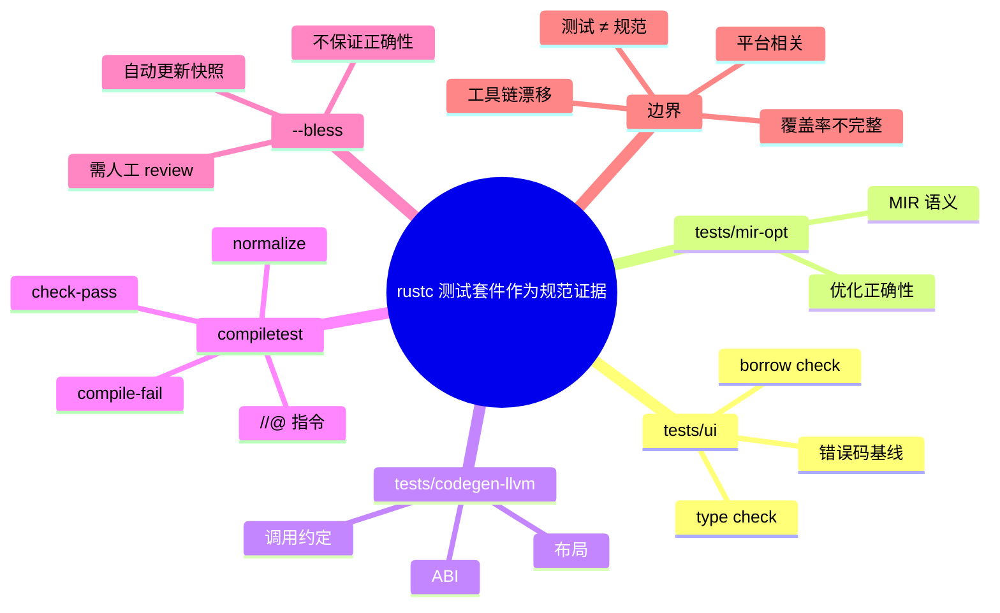

# 从 rustc 测试套件提取规范证据

**EN**: Specification Evidence from the rustc Test Suite
**Summary**: Describes how the rustc test suite—`tests/ui`, `tests/mir-opt`, `tests/codegen-llvm`, and the compiletest framework—serves as empirical specification evidence while distinguishing it from a normative specification.

> **Rust 版本**: 1.97.0+ (Edition 2024)
> **Bloom 层级**: L3-L4
> **权威来源**: 本文件为 `concept/` 权威页。
> **关联 L3 页**: [Unsafe Rust](../../03_advanced/02_unsafe/01_unsafe.md)

---

## 1. 测试套件作为规范证据

rustc 的“实现即规范”现状意味着：想了解 Rust 的精确行为，必须查看编译器实际接受/拒绝什么程序。rustc 测试套件因此成为**规范一致性证据库**，主要分为：

| 目录 | 内容 | 规范价值 |
|---|---|---|
| `tests/ui/` | UI 测试：编译错误、警告、borrow check、类型检查示例 | 错误码与报错 wording 的基线 |
| `tests/mir-opt/` | MIR 优化与生成基线 | 中间表示语义与优化正确性 |
| `tests/codegen-llvm/` | LLVM IR 生成检查 | ABI、布局、调用约定 |
| `tests/codegen/` / `tests/assembly/` | 汇编与目标代码检查 | 平台相关语义 |
| `tests/run-make/` | 构建流程测试 | 工具链集成行为 |

这些测试不是规范本身，而是**规范主张的实例化证据**：如果规范说“此程序应产生 E0502”，那么 `tests/ui/` 中对应测试就是该主张的证据。

---

## 2. compiletest 指令（速查）

compiletest 是 rustc 的测试框架，使用 `//@` 指令描述测试期望。典型指令包括：

```rust,ignore
//@ edition: 2024
//@ check-pass
//@ stderr-per-bitwidth
//@ normalize-stderr-test: "[0-9]+" -> "N"

fn main() {
    println!("hello, compiletest");
}
```

常用指令含义：

| 指令 | 含义 |
|---|---|
| `check-pass` | 编译通过即可，不运行 |
| `run-pass` | 编译并运行通过 |
| `compile-fail` | 编译失败，期望有特定错误 |
| `build-fail` | 构建失败 |
| `stderr-per-bitwidth` | 错误输出因指针宽度而异 |
| `normalize-stderr-test` | 归一化 stderr 以避免无关差异 |
| `edition: 2024` | 指定 Edition |

完整指令参考见 [rustc-dev-guide — Compiletest](https://rustc-dev-guide.rust-lang.org/tests/compiletest.html)。

---

## 3. “规范证据”的操作性定义与判定程序

**定义**：测试 T 是规范主张 c 的**证据**，当且仅当：(i) T 的 `//@` 指令与期望快照（`.stderr`/`.stdout`/`.mir`）完全固定 c 的判定结果；(ii) T 在 CI 中每次编译器变更都重跑；(iii) 快照变更（`--bless`）经过语义评审。测试不是规范：它只断言“这个输入产生这个输出”，不解释“为什么”。

**判定程序（从测试提取规范主张）**：

1. 读测试头部指令（`//@ edition:`、`//@ check-pass`、`//@ compile-fail`、revision `//@ [X] ...`）。
2. 读期望快照：错误码（E0xxx）、警告码、诊断文本结构（`$DIR` 归一化、`normalize-stderr-test`）。
3. 反向陈述主张：“在 Edition N 下，此程序必须产生且仅产生这些诊断。”
4. 交叉验证：本地 `rustc --edition N` 复现（本页所有实例均在 rustc 1.99.0 复现）。
5. 检查 compare-mode/revision：同一测试在不同模式（如 next-solver）下的不同期望，本身就是“行为随求解器实现变化”的规范缺口证据。

## 4. 实例深读：一个真实 UI 测试的完整证据链（rustc 1.99.0 复现）

`tests/ui/unsafe/edition-2024-unsafe_op_in_unsafe_fn.rs`（main 分支原文）：

```rust,ignore
//@ edition: 2024
//@ check-pass
#![crate_type = "lib"]
#![deny(unused_unsafe)]

unsafe fn unsf() {}

unsafe fn foo() {
    unsf();
    //~^ WARN call to unsafe function `unsf` is unsafe and requires unsafe block

    // no unused_unsafe
    unsafe {
        unsf();
    }
}
```

配套 `.stderr` 快照（原文摘录）：

```text
warning[E0133]: call to unsafe function `unsf` is unsafe and requires unsafe block
  --> $DIR/edition-2024-unsafe_op_in_unsafe_fn.rs:9:5
   |
LL |     unsf();
   |     ^^^^^^ call to unsafe function
   |
note: an unsafe function restricts its caller, but its body is safe by default
  --> $DIR/edition-2024-unsafe_op_in_unsafe_fn.rs:8:1
   |
LL | unsafe fn foo() {
   | ^^^^^^^^^^^^^^^
   = note: `#[warn(unsafe_op_in_unsafe_fn)]` (part of `#[warn(rust_2024_compatibility)]`) on by default
```

**提取的主张**（全部本地复现）：

1. Edition 2024 下 `unsafe_op_in_unsafe_fn` 是 **warn-by-default**（`check-pass`：警告不阻断编译）。
2. 警告带错误码 E0133（warning 也挂错误码——诊断即证据的粒度）。
3. `unsafe { unsf(); }` 显式块不触发 `unused_unsafe`（`#![deny(unused_unsafe)]` 下仍通过）。
4. 诊断 note 文本“an unsafe function restricts its caller, but its body is safe by default”是 Edition 2024 语义的编译器自述。

本地最小复现（rustc 1.99.0，`--edition 2024` 产生同款 warning[E0133]；`--edition 2021` 无此警告；`#[deny(unsafe_op_in_unsafe_fn)]` + Edition 2021 则升级为 error[E0133]）：

```rust,compile_fail
#[deny(unsafe_op_in_unsafe_fn)]
unsafe fn deref(p: *const i32) -> i32 {
    *p // error[E0133]：lint 被 deny 后 Edition 2021 也硬错误
}
fn main() {}
```

## 5. 反例与边界案例

### 5.1 反例 A：测试目录存在 ≠ 主张有规范——`unsafe` 目录的覆盖盲区

`tests/ui/unsafe/` 实测目录清单（GitHub API，2026-10-13）含 `unsafe-fn-called-from-safe.rs`、`unsafe-not-inherited.rs`、`edition-2024-unsafe_op_in_unsafe_fn.rs` 等 30+ 测试，但**没有**测试断言“`unsafe fn` 体内 UB 前提的完备清单”——静态可诊断的 unsafe 操作有测试，动态 UB 前提（FLS 19:4–19:9 枚举的语义后果）无 UI 测试可断言。证据库覆盖的是“编译器说什么”，不是“语言承诺什么”。

### 5.2 反例 B：`--bless` 掩盖语义回归的最小构造

设想某变更把 Edition 2024 的 `unsafe_op_in_unsafe_fn` 从 warn 降为 silent：`./x.py test tests/ui --bless` 会把 `.stderr` 快照清空，测试继续“通过”。该测试的 `check-pass` 指令不检查警告存在性——只有快照 diff 评审才能发现回归。**结论**：`check-pass` 类测试的证据强度低于带 `.stderr` 断言的测试；提取规范主张时必须看快照而非只看指令。

### 5.3 边界案例 C：诊断文本不是规范（FLS 1.1.1:12 同理）

UI 测试快照锁定诊断 wording，但 wording 变更（措辞改进、`help:` 行增删）routinely 通过 `--bless` 接受。因此从 UI 测试提取主张时应**只提取错误码与接受/拒绝结论**，不提取自然语言文本——文本证据等级最低。跨版本稳定性排序：接受/拒绝 > 错误码 > 诊断结构（span 标注） > 措辞。

### 5.4 边界案例 D：revision 与 compare-mode 暴露“多实现并存”

现代 UI 测试可用 `//@ revisions: current next` 同时断言旧/新 trait solver 的不同输出；CI 的 `--compare-mode`（如 next-solver）单独跑。同一程序两套期望输出并存，说明该行为的“规范”目前绑定于求解器实现选择——正是 a-mir-formality 要消解的缺口（见 04 号页 §7 互证机制）。

## 6. 运行测试

在 rust-lang/rust 仓库中，典型命令如下：

```bash
# 运行全部 UI 测试（stage 1 编译器）
./x.py test tests/ui --stage 1

# 运行 MIR-opt 测试
./x.py test tests/mir-opt --stage 1

# 运行 codegen-llvm 测试
./x.py test tests/codegen-llvm --stage 1

# 仅运行与借用检查相关的测试
./x.py test tests/ui/borrowck --stage 1
```

> 这些命令需要在 rust-lang/rust 完整 checkout 中执行，并配置 `config.toml`；普通项目无需也无法直接运行。

---

## 7. `--bless` 的风险

当测试期望输出需要更新时，开发者使用 `--bless`：

```bash
./x.py test tests/ui --stage 1 --bless
```

`--bless` 会**自动重写** `.stderr`、`.stdout`、`.mir` 等期望文件。这意味着：

- 它只是更新快照，不验证新行为是否正确。
- 如果编译器引入了回归性变更， `--bless` 会让测试“看起来通过”。
- 因此， `--bless` 后的 diff 必须经过人工 review，不能作为质量保证的终点。

---

## 8. 反命题与边界

### 8.1 常见过度概括

- ❌ “测试覆盖率 = 规范完备性。” → ✅ 测试只覆盖已写入用例的行为；未测试的 corner case 仍可能无规范定义。
- ❌ “`--bless` 让测试通过 = 行为正确。” → ✅ `--bless` 只同步快照；正确性仍需语义审查。
- ❌ “rustc tests 是规范。” → ✅ 测试是证据，不是规范陈述；规范需要解释“为什么接受/拒绝”。
- ❌ “所有 rustc 行为都有测试覆盖。” → ✅ 许多实现细节依赖内部约定，测试并未穷尽。

### 8.2 工程边界

- **测试先于规范 vs 规范先于测试**：理想情况下，新特性稳定化时应同时附带规范章节与测试；但现实中常出现“实现 + 测试先行，规范滞后”。
- **尚未稳定的特性**：尚未稳定的特性可能快速变化，测试是其唯一稳定描述；但测试不会解释设计意图。
- **平台相关行为**：codegen/assembly 测试高度依赖目标平台，不能跨平台直接作为规范。

---

## 9. 国际权威来源

- [rustc-dev-guide — Compiletest](https://rustc-dev-guide.rust-lang.org/tests/compiletest.html)
- [rustc-dev-guide — Directives（`//@` 指令全表）](https://rustc-dev-guide.rust-lang.org/tests/directives.html)
- [rustc-dev-guide — UI 测试套件与 compare-mode](https://rustc-dev-guide.rust-lang.org/tests/ui.html)
- [UI 测试实例：tests/ui/unsafe/edition-2024-unsafe_op_in_unsafe_fn.rs](https://github.com/rust-lang/rust/blob/main/tests/ui/unsafe/edition-2024-unsafe_op_in_unsafe_fn.rs)
- [UI 测试快照：同名 .stderr（warning[E0133] 基线）](https://github.com/rust-lang/rust/blob/main/tests/ui/unsafe/edition-2024-unsafe_op_in_unsafe_fn.stderr)
- [UI 测试实例：tests/ui/borrowck/assign-imm-local-twice.rs](https://github.com/rust-lang/rust/blob/main/tests/ui/borrowck/assign-imm-local-twice.rs)
- [rust-lang/rust tests/ui/](https://github.com/rust-lang/rust/tree/master/tests/ui)
- [rust-lang/rust tests/mir-opt/](https://github.com/rust-lang/rust/tree/master/tests/mir-opt)
- [rust-lang/rust tests/codegen-llvm/](https://github.com/rust-lang/rust/tree/master/tests/codegen-llvm)
- [Inside Rust — Test Infra Jan/Feb 2025](https://blog.rust-lang.org/inside-rust/2025/03/11/test-infra-jan-feb-2025.html)

---

## 10. 与其他概念的关系

- [编译器测试](../../06_ecosystem/00_toolchain/13_compiler_testing.md) — compiletest、UI tests、Crater、rustc-perf 的详细说明。
- [rustc driver 与 Stable MIR](../../06_ecosystem/00_toolchain/10_rustc_driver_and_stable_mir.md) — 把 rustc 当库用，提取规范证据。
- [Rust Reference 与规范性缺口](01_rust_reference_and_normative_gap.md) — 测试证据与自然语言规范的关系。
- [a-mir-formality：类型系统形式化](04_a_mir_formality_type_system_spec.md) — 形式化模型与测试基线如何互证。

---

## 🧭 思维导图（Mindmap）



---

## 国际权威来源（P1 补充）

- [Assessing the alignment between the information needs of developers and the documentation of programming languages: a case study on Rust](https://arxiv.org/abs/2202.04431)
