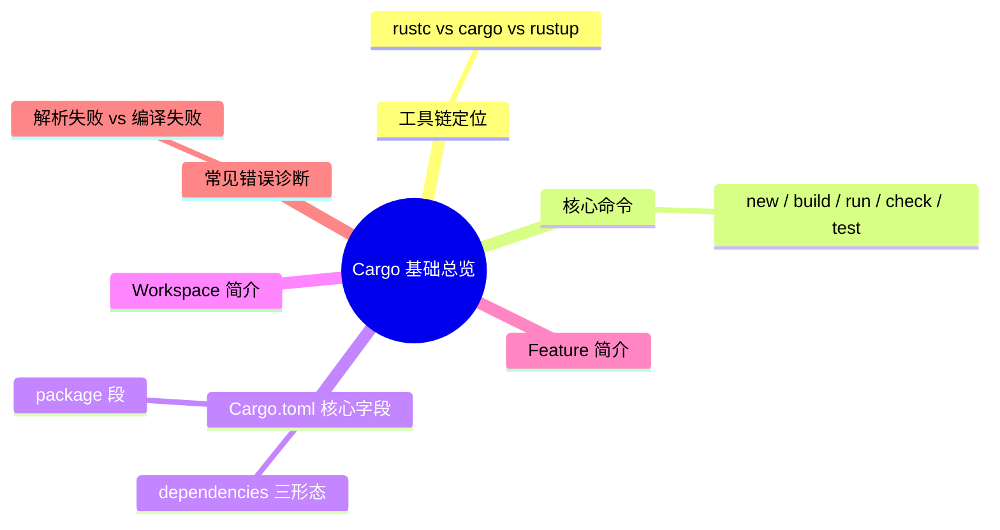

# Cargo 基础总览（Cargo Basics）

> **内容分级**: [综述级]
> **本节关键术语**: Cargo · Package · Manifest · `Cargo.toml` · Target · Feature — [完整对照表](../../00_meta/01_terminology/01_terminology_glossary.md)
>
> **EN**: Cargo Basics
> **Summary**: A foundational map of Cargo for Rust 1.99.0+: what Cargo is relative to `rustc`, the five core commands (`new`/`build`/`run`/`check`/`test`), the essential `Cargo.toml` fields, a first look at workspaces and features, and a diagnostic table for the most common Cargo errors.
> **Rust 版本**: 1.99.0+ (Edition 2024)
> **受众**: [初学者]
> **Bloom 层级**: L1-L3
> **权威来源**: 本文件为 `concept/` 权威页（范围仅限 Cargo 基础命令与 `Cargo.toml` 核心字段的总览；依赖解析、workspace、manifest 全字段等专题由各自权威页维护，见第七节边界表）。
> **A/S/P 标记**: **A** — Application
> **双维定位**: E×Tool — 工具链与生态系统
> **定位**: 提供一张 Cargo「基础地图」：先建立命令与 manifest 的整体心智模型，再按边界表跳转到各专题权威页深读。
> **定理链**: N/A — 描述性/综述性/导航性文档，不涉及形式化定理链
> **前置概念**: [Toolchain](../00_toolchain/01_toolchain.md) · [Cargo 入门](15_cargo_getting_started.md)
> **后置概念**: [Cargo Workspaces](14_cargo_workspaces.md) · [Cargo Manifest Reference](10_cargo_manifest_reference.md) · [Cargo Commands Reference](19_cargo_commands_reference.md) · [Cargo Dependency Resolution](06_cargo_dependency_resolution.md)

---

> **来源**: [Cargo Book — Why Cargo Exists](https://doc.rust-lang.org/cargo/index.html) · [Cargo Book — Commands](https://doc.rust-lang.org/cargo/commands/index.html) · [Cargo Book — The Manifest Format](https://doc.rust-lang.org/cargo/reference/manifest.html) · [TRPL — Getting Started](https://doc.rust-lang.org/book/ch01-00-getting-started.html) · [Rust Reference — Crates and Modules](https://doc.rust-lang.org/reference/crates-and-modules.html)

---

## 一、Cargo 在工具链中的定位

`rustc` 是编译器，Cargo 是**构建系统 + 包管理器 + 项目编排器**。日常 Rust 开发几乎不直接调用 `rustc`：Cargo 负责发现 package、解析并下载依赖、按 profile 调用 `rustc`、运行测试与文档工具。官方建议把 Cargo 作为默认入口（[Cargo Book — Why Cargo Exists](https://doc.rust-lang.org/cargo/index.html)）。

| 层 | 工具 | 职责 |
|:---|:---|:---|
| 编译器 | `rustc` | 单 crate 编译、单文件检查 |
| 构建/包管理 | `cargo` | 依赖解析、构建编排、测试、发布 |
| 工具链管理 | `rustup` | 安装/切换 toolchain 与组件 |

> **心智模型**: Cargo 把「一个 crate 的编译问题」升级为「一个 package 及其依赖图的工程问题」。理解 Cargo 的基础 = 理解 **命令 → manifest → 依赖图** 这条主线。

---

## 二、五个核心命令

以下命令覆盖日常开发的主循环（[Cargo Book — Commands](https://doc.rust-lang.org/cargo/commands/index.html)）：

| 命令 | 作用 | 关键细节 |
|:---|:---|:---|
| `cargo new <name>` | 创建新 package（默认二进制；`--lib` 建库） | 生成 `Cargo.toml` + `src/main.rs`（或 `src/lib.rs`）；在已有目录内用 `cargo init` |
| `cargo build` | 编译 package 及其依赖 | 默认 debug profile；产物在 `target/debug/`；`--release` 走优化 profile |
| `cargo run` | 编译并立即运行二进制 | 等价于 `cargo build` + 执行；`--` 之后的参数传给程序 |
| `cargo check` | 只做类型检查/借用检查，不生成二进制 | 比 `cargo build` 快，是日常「快速验证」首选 |
| `cargo test` | 编译并运行测试 | 覆盖单元测试、集成测试（`tests/`）、文档测试三种测试形态 |

最小工作流（[TRPL Ch01](https://doc.rust-lang.org/book/ch01-03-testing.html)）：

```bash
cargo new hello_cargo
cd hello_cargo
cargo run          # 编译 + 运行
cargo check        # 快速验证，不产出二进制
cargo test         # 运行测试
```

### 命令与 rustc 的对应关系

| 直接 rustc 做法 | Cargo 等价 | Cargo 额外收益 |
|:---|:---|:---|
| `rustc main.rs` | `cargo build` | 依赖解析、增量缓存、profile 管理 |
| `rustc --test` 后手动执行 | `cargo test` | 测试发现、文档测试、集成测试编排 |
| 手写 `--extern` 链接第三方库 | `[dependencies]` + `cargo build` | 版本解析、lockfile 锁定 |

> **注意**: `cargo check` 不产出可执行文件，因此不能替代 `cargo build`/`cargo run`；它验证的是「能否通过编译」，不是「产物行为」。

---

## 三、`Cargo.toml` 核心字段

`Cargo.toml`（manifest）是 Cargo 读取的唯一项目描述文件（[Cargo Book — Manifest Format](https://doc.rust-lang.org/cargo/reference/manifest.html)）。一个最小可用的 manifest：

```toml
[package]
name = "hello_cargo"
version = "0.1.0"
edition = "2024"
rust-version = "1.99.0"

[dependencies]
```

| 字段 | 所属段 | 作用 | 备注 |
|:---|:---|:---|:---|
| `name` | `[package]` | package 名称，发布到 registry 时的唯一标识 | 不能与 crate 名规则冲突 |
| `version` | `[package]` | SemVer 版本号 | 发布 crates.io 必填 |
| `edition` | `[package]` | 语言 Edition（`2015`/`2018`/`2021`/`2024`） | Edition 2024 隐式启用 resolver v3 |
| `rust-version` | `[package]` | MSRV（最低可编译的 Rust 版本） | 低于该版本时 Cargo 提前报错而非 rustc 报错 |
| `resolver` | `[package]`/`[workspace]` | 依赖解析算法版本（`1`/`2`/`3`） | 通常由 `edition` 推断，virtual workspace 必须显式给出 |
| `[dependencies]` | — | 正常编译依赖 | 版本为 SemVer 要求，如 `"1.0"` 表示 `>=1.0.0, <2.0.0` |
| `[dev-dependencies]` | — | 仅测试/示例/基准用到的依赖 | 不传递给下游消费者 |
| `[build-dependencies]` | — | `build.rs` 脚本用到的依赖 | 与运行时依赖分离 |
| `[features]` | — | 条件编译开关（见第五节） | 默认 feature 列表写在 `default = [...]` |
| `[workspace]` | — | 声明多 package 工作区（见第四节） | 成员共享一个 `Cargo.lock` 与 `target/` |

依赖声明的三种常见形态：

```toml
[dependencies]
serde = "1"                                        # 仅版本要求
rand = { version = "0.9", default-features = false }  # 表形式：关默认 feature
mylib = { path = "../mylib" }                      # path 依赖（本地 crate）
```

> **版本要求语义**: `"1.2.3"` 是 caret 要求 `>=1.2.3, <2.0.0`；`"~1.2.3"` 是 tilde 要求 `>=1.2.3, <1.3.0`；`"*"` 接受任意版本。详见 [Cargo Book — Specifying Dependencies](https://doc.rust-lang.org/cargo/reference/specifying-dependencies.html)。

---

## 四、Workspace 简介

Workspace 把多个 package 组织在一起共享一个 `Cargo.lock`、一个 `target/` 目录和一套继承配置（[Cargo Book — Workspaces](https://doc.rust-lang.org/cargo/reference/workspaces.html)）。最小声明：

```toml
[workspace]
members = ["crates/*"]
resolver = "3"

[workspace.package]
edition = "2024"
rust-version = "1.99.0"

[workspace.dependencies]
serde = "1"
```

成员 package 通过 `version.workspace = true` 等写法继承根配置。两种拓扑：**root package**（根 `Cargo.toml` 同时有 `[package]` 与 `[workspace]`）与 **virtual workspace**（只有 `[workspace]`，必须显式写 `resolver`）。`cargo build --workspace`、`cargo test --workspace` 让命令作用于全部成员。

> 本页只建立「workspace 是什么、何时用」的第一印象；`members`/`exclude`/`default-members`、lint 继承、`[patch]` 只在 root manifest 生效等完整语义见权威页 [Cargo Workspaces](14_cargo_workspaces.md)。

## 五、Feature 简介

Feature 是 package 自我声明的**条件编译开关**（[Cargo Book — Features](https://doc.rust-lang.org/cargo/reference/features.html)）。库作者用它切分子集功能，消费者按需开启：

```toml
[features]
default = ["std"]
std = []
serde_support = ["dep:serde"]

[dependencies]
serde = { version = "1", optional = true }
```

命令行侧：`cargo build --features serde_support`、`cargo test --no-default-features`。`dep:xxx` 语法表示「启用该 feature 才引入可选依赖」。feature 命名规范为 kebab-case，且不能与 Rust 关键字冲突。

> **边界提示**: feature 在依赖图中的**合并（feature unification）语义**、resolver v3 下的 feature 传播与 `public = true` 属于专题内容，见 [Cargo Dependency Resolution](06_cargo_dependency_resolution.md) 与 [Resolver v3 与 `public = true` 的 feature unification 演示](03_resolver_v3_public_feature_unification.md)。

---

## 六、常见错误诊断

初学者最常撞到的 Cargo 层错误及第一反应（错误文本以 Cargo Book 命令页与 rustc 诊断惯例为准）：

| 症状 | 典型报错 | 根因 | 第一反应 |
|:---|:---|:---|:---|
| 找不到命令目标 | `error: no VCS found for this package`（`cargo new` 时） | 环境无版本控制后端 | 加 `--vcs none` 或先 `git init` |
| 依赖版本无匹配 | `error: failed to select a version for the requirement ...` | SemVer 要求与 registry 现有版本冲突 | 放宽版本要求或 `cargo update`；深读 [Cargo Dependency Resolution](06_cargo_dependency_resolution.md) |
| lockfile 过期/冲突 | `error: the lock file ... needs to be updated but --locked was passed` | `Cargo.lock` 与 manifest 不一致 | 不带 `--locked` 跑一次 `cargo generate-lockfile` 或 `cargo update` |
| 包名/目录不符 | `error: no `Cargo.toml` found`（在错误目录执行命令） | 当前目录不在 package 内 | `cd` 到含 `Cargo.toml` 的目录，或用 `--manifest-path` |
| MSRV 不满足 | `error: package ... cannot be built because it requires rustc 1.99.0 or newer` | 本机 toolchain 低于依赖声明的 `rust-version` | `rustup update` 或降低该依赖版本 |
| feature 拼错 | `error: none of the selected packages contains these features: ...` | `--features` 名单与 manifest 不符 | 核对 `[features]` 段拼写与 kebab-case |
| 循环 path 依赖 | `error: cyclic package dependency: package ... depends on itself` | workspace 内 path 依赖成环 | 抽出公共 crate 打破环 |
| 二进制歧义 | `error: `cargo run` could not determine which binary to run` | 多个 `[[bin]]` 目标 | `cargo run --bin <name>` 显式指定 |

### 诊断顺序（通用流程）

1. **先读第一行错误**：Cargo 层错误（`failed to select`、`failed to download`）发生在编译之前，问题在 manifest/网络/lockfile；rustc 层错误（`error[E0xxx]`）发生在编译期，问题在源码。
2. **最小化复现**：`cargo check` 比 `cargo build` 快，先用它定位；必要时 `cargo build -v` 看 Cargo 实际传给 `rustc` 的调用。
3. **区分「解析失败」与「编译失败」**：前者修 `Cargo.toml`/`Cargo.lock`，后者修源码——这是 Cargo 新手最常见的混淆点。

---

## 七、本页边界：与专题权威页的分工

本页只覆盖「Cargo 基础总览」这一范围（核心命令、manifest 核心字段、workspace/feature 的第一印象、常见错误诊断）。以下主题各有专题权威页，本页不重复其正文：

| 主题 | 专题权威页 |
|:---|:---|
| 从零创建并运行第一个 package | [Cargo 入门](15_cargo_getting_started.md) |
| 日常开发流程、`Cargo.toml` vs `Cargo.lock`、项目布局 | [Cargo 工作流](16_cargo_workflow.md) |
| 全部子命令分类速查 | [Cargo 命令参考](19_cargo_commands_reference.md) |
| manifest 全字段参考 | [Cargo Manifest 参考速查](10_cargo_manifest_reference.md) |
| workspace 完整语义（`members`/继承/`[patch]`） | [Cargo Workspaces](14_cargo_workspaces.md) |
| 依赖解析算法与 resolver 版本 | [Cargo 依赖解析](06_cargo_dependency_resolution.md) |
| 配置文件与环境变量 | [Cargo 配置与环境变量](18_cargo_configuration.md) |
| 构建脚本 `build.rs` | [Cargo Build Scripts](05_cargo_build_scripts.md) |

---

## 相关概念

- [Rust vs Go](../../05_comparative/01_systems_languages/03_rust_vs_go.md) — 工具链对比视角（L5）：Go 单二进制工具链 vs Rust cargo/rustup 分层
- [Cargo Workspaces](14_cargo_workspaces.md) · [Cargo Manifest Reference](10_cargo_manifest_reference.md)

## 🧭 思维导图（Mindmap）



## ⚠️ 反例与陷阱

### 反例 1：把「解析失败」当「编译失败」去改源码

`cargo build` 报 `error: failed to select a version for the requirement "serde = \"2.0\""` 时，源码没有任何问题——crates.io 上不存在满足 `>=2.0.0, <3.0.0` 的 serde 版本。正确动作是修 `Cargo.toml` 的版本要求（如改回 `"1"`），而不是改 `src/` 下的代码。

### 反例 2：用 `cargo check` 通过后直接 `cargo run --release` 期待产物

`cargo check` 不生成二进制也不做链接；类型检查通过不代表 release 链接阶段（如缺失系统库）能通过。发布验证应跑 `cargo build --release`。

### 反例 3：库 crate 提交 `Cargo.lock` 的默认预期

纯库 package 通常不提交 `Cargo.lock`（下游用自己的解析结果）；二进制 package 则应提交以保证可复现构建。判据与理由见 [Cargo 工作流](16_cargo_workflow.md)。

### ✅ 正确姿势：先 `check` 后 `build`，报错先分层

```bash
cargo check            # 第一步：快速验证源码可通过编译
cargo build --release  # 第二步：产出正式二进制
cargo test             # 第三步：测试
```

---

> **权威来源**: [Cargo Book — Commands](https://doc.rust-lang.org/cargo/commands/index.html) · [Cargo Book — The Manifest Format](https://doc.rust-lang.org/cargo/reference/manifest.html) · [Cargo Book — Workspaces](https://doc.rust-lang.org/cargo/reference/workspaces.html) · [Cargo Book — Features](https://doc.rust-lang.org/cargo/reference/features.html) · [TRPL — Getting Started](https://doc.rust-lang.org/book/ch01-00-getting-started.html)
