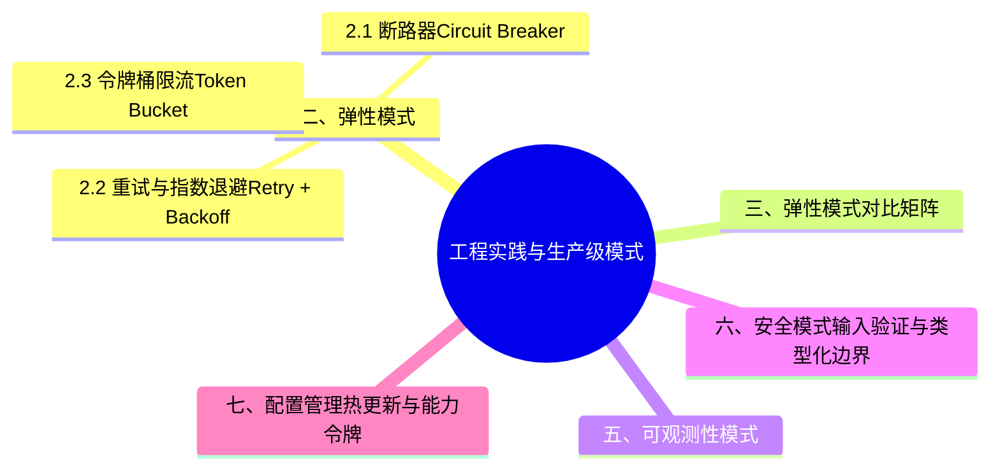

> **内容分级**: [专家级]
> **Bloom 层级**: L5-L6
> **定理链**: N/A — 描述性/综述性/导航性文档，不涉及形式化定理链
> **代码状态**: ✅ 含可编译示例
>
# 工程实践与生产级模式
>
> **EN**: Engineering Practice and Production-Grade Patterns
> **Summary**: Rust production-grade patterns: circuit breaker, retry, rate limiting, graceful degradation, observability, safe configuration, and graceful shutdown.
> **Rust 版本**: 1.97.0+ (Edition 2024)
>
> **受众**: [专家]
> **权威来源**: 本文件为 `concept/` 权威页。
> **层级**: L6 生态工程
> **A/S/P 标记**: **P+S+A** — Procedure + Structure + Application
> **前置概念**: [Architecture Patterns](08_architecture_patterns.md) · [Error Handling](../../02_intermediate/03_error_handling/01_error_handling.md) · [Concurrency](../../03_advanced/00_concurrency/01_concurrency.md)
> **后置概念**: [Microservice Patterns](05_microservice_patterns.md) · [Event-Driven Architecture](06_event_driven_architecture.md)
> **相关概念**: [Pattern Implementation Comparison](09_pattern_implementation_comparison.md) · [Pattern Selection Best Practices](10_pattern_selection_best_practices.md) · [System Design Principles](03_system_design_principles.md) · [Algorithm Engineering Practice](../11_domain_applications/08_algorithm_engineering_practice.md) · [Rust vs C++](../../05_comparative/01_systems_languages/01_rust_vs_cpp.md) — 工程模式在两种系统语言中的表达对比 · [Paradigm Matrix](../../05_comparative/00_paradigms/01_paradigm_matrix.md) — 生产模式的范式坐标
>
> **来源**: [Rust API Guidelines](https://rust-lang.github.io/api-guidelines/) · [Release It! — Michael Nygard](https://pragprog.com/titles/mnee2/release-it-second-edition/) · [Site Reliability Engineering](https://sre.google/sre-book/table-of-contents/) · [The Rust Programming Language](https://doc.rust-lang.org/book/title-page.html)

---

## 一、概述

生产级 Rust 应用需要在**弹性、可观测性、性能、安全、配置管理**五个维度建立系统化实践。与经典设计模式相比，工程与生产级模式更关注**故障模型、运行期行为与可运维性**，并充分利用 Rust 的所有权（Ownership）、类型安全和零成本抽象（Zero-Cost Abstraction）来在编译期消除一类运行时（Runtime）错误。

## 二、弹性模式

弹性模式三件套分别防御不同故障传播路径：断路器（关闭→打开→半开三态，下游持续故障时快速失败，阻止故障级联放大）；重试+指数退避（瞬时故障自愈，必须配 jitter 与上限，否则变成放大故障的元凶）；令牌桶限流（保护自身容量，以可预测的拒绝替代不可预测的过载崩溃）。三者部署顺序有讲究：限流守入口、断路器守出口、重试只在幂等操作上启用——顺序错了会互相放大负面效果。

### 2.1 断路器（Circuit Breaker）

当下游服务持续失败时，快速失败以避免线程/连接池被耗尽，并在超时后进入半开状态探测恢复。

```rust
use std::sync::atomic::{AtomicUsize, Ordering};
use std::sync::Mutex;
use std::time::{Duration, Instant};

#[derive(Clone, Copy, PartialEq)]
pub enum State { Closed, Open, HalfOpen }

pub struct CircuitBreaker {
    threshold: usize,
    timeout: Duration,
    state: AtomicUsize,      // 0=Closed, 1=Open, 2=HalfOpen
    failures: AtomicUsize,
    last_failure: Mutex<Option<Instant>>,
}

impl CircuitBreaker {
    pub fn new(threshold: usize, timeout: Duration) -> Self {
        Self {
            threshold,
            timeout,
            state: AtomicUsize::new(0),
            failures: AtomicUsize::new(0),
            last_failure: Mutex::new(None),
        }
    }

    fn state(&self) -> State {
        match self.state.load(Ordering::Acquire) {
            1 => State::Open,
            2 => State::HalfOpen,
            _ => State::Closed,
        }
    }

    pub fn call<F, T, E>(&self, f: F) -> Result<T, E>
    where
        F: FnOnce() -> Result<T, E>,
    {
        if self.state() == State::Open {
            let elapsed = self.last_failure.lock().unwrap()
                .map(|t| t.elapsed()).unwrap_or(Duration::MAX);
            if elapsed < self.timeout {
                // 生产环境中应返回自定义错误：断路器开启
                return f(); // 简化示例
            }
            self.state.store(2, Ordering::Release);
        }

        match f() {
            Ok(v) => {
                self.failures.store(0, Ordering::Release);
                self.state.store(0, Ordering::Release);
                Ok(v)
            }
            Err(e) => {
                let n = self.failures.fetch_add(1, Ordering::AcqRel) + 1;
                if n >= self.threshold {
                    *self.last_failure.lock().unwrap() = Some(Instant::now());
                    self.state.store(1, Ordering::Release);
                }
                Err(e)
            }
        }
    }
}
```

### 2.2 重试与指数退避（Retry + Backoff）

```rust
use std::thread;
use std::time::Duration;

pub fn with_retry<F, T, E>(mut op: F, max_attempts: u32) -> Result<T, E>
where
    F: FnMut() -> Result<T, E>,
{
    let mut attempts = 0;
    loop {
        match op() {
            Ok(v) => return Ok(v),
            Err(e) => {
                attempts += 1;
                if attempts >= max_attempts {
                    return Err(e);
                }
                let backoff = Duration::from_millis(2u64.pow(attempts.min(6)) * 10);
                thread::sleep(backoff);
            }
        }
    }
}
```

### 2.3 令牌桶限流（Token Bucket Rate Limiter）

```rust
use std::sync::atomic::{AtomicUsize, Ordering};
use std::sync::Mutex;
use std::time::{Duration, Instant};

pub struct TokenBucket {
    max: usize,
    refill_per_sec: f64,
    tokens: AtomicUsize,
    last_refill: Mutex<Instant>,
}

impl TokenBucket {
    pub fn new(max: usize, refill_per_sec: f64) -> Self {
        Self {
            max,
            refill_per_sec,
            tokens: AtomicUsize::new(max),
            last_refill: Mutex::new(Instant::now()),
        }
    }

    pub fn acquire(&self, n: usize) -> bool {
        let mut last = self.last_refill.lock().unwrap();
        let elapsed = last.elapsed().as_secs_f64();
        let available = (self.tokens.load(Ordering::Acquire) as f64
            + elapsed * self.refill_per_sec).min(self.max as f64) as usize;
        self.tokens.store(available, Ordering::Release);
        *last = Instant::now();
        drop(last);

        if available < n {
            return false;
        }
        self.tokens.fetch_sub(n, Ordering::AcqRel) >= n
    }
}
```

## 三、弹性模式对比矩阵

| 模式 | 防御对象 | 触发条件 | 恢复策略 | Rust 关键类型 | 典型位置 |
|:---|:---|:---|:---|:---|:---|
| **Circuit Breaker** | 持续失败/级联故障 | 失败次数 ≥ 阈值 | 超时后半开探测 | `AtomicUsize` + `Mutex<Instant>` | 下游 RPC/数据库 |
| **Retry** | 瞬态网络抖动 | 返回可重试错误 | 指数退避 | `std::thread::sleep` | 客户端调用 |
| **Rate Limiter** | 流量过载 | 请求速率超过配额 | 令牌补充 | `AtomicUsize` + `Mutex<Instant>` | 网关/API 入口 |
| **Bulkhead** | 资源争用 | 线程池/信号量耗尽 | 隔离失败域 | `tokio::sync::Semaphore` | 关键依赖池 |
| **Fallback** | 功能不可用 | 主路径失败 | 返回默认值/缓存 | `match` + 静态值 | 读密集服务 |

## 四、模式选择决策树

```text
生产级弹性模式选择
│
├─ 错误是瞬态且可恢复？
│  ├─ 是 → Retry（指数退避 + 最大重试次数）
│  └─ 否 → Circuit Breaker
│
├─ 入口流量可能突增？
│  ├─ 是 → Rate Limiter
│  └─ 否 → 直接放行
│
├─ 多个下游依赖共享资源？
│  ├─ 是 → Bulkhead（舱壁隔离）
│  └─ 否 → 统一调度
│
└─ 需要保证最低可用性？
   ├─ 是 → Fallback（兜底/降级）
   └─ 否 → 快速失败
```

## 五、可观测性模式

| 模式 | 目的 | Rust 生态 |
|:---|:---|:---|
| 结构化日志 | 统一、可解析的日志输出 | `tracing` + `tracing-subscriber` |
| Metrics 收集 | 请求量、延迟、错误率量化 | `prometheus`, `metrics` |
| 分布式追踪 | 跨服务请求链路可视化 | `opentelemetry`, `tracing-opentelemetry` |

```rust,ignore
use tracing::{info, instrument};

#[instrument]
pub async fn handle_order(order_id: u64) -> Result<(), &'static str> {
    info!(order_id, "processing order");
    Ok(())
}
```

## 六、安全模式：输入验证与类型化边界

```rust
#[derive(Debug, Clone, PartialEq)]
pub struct SanitizedEmail(String);

impl SanitizedEmail {
    pub fn new(raw: &str) -> Result<Self, &'static str> {
        if raw.len() > 254 || !raw.contains('@') {
            return Err("invalid email format");
        }
        // 可继续集成 DNS/MX 检查、正则白名单等
        Ok(Self(raw.to_lowercase()))
    }

    pub fn as_str(&self) -> &str { &self.0 }
}
```

## 七、配置管理：热更新与能力令牌

```rust,ignore
use arc_swap::ArcSwap;
use std::sync::Arc;

pub struct AppConfig {
    pub max_retries: u32,
    pub timeout_ms: u64,
}

static CONFIG: ArcSwap<AppConfig> = ArcSwap::from_pointee(AppConfig {
    max_retries: 3,
    timeout_ms: 1000,
});

pub fn update_config(new: AppConfig) {
    CONFIG.store(Arc::new(new));
}

pub fn current_config() -> Arc<AppConfig> {
    CONFIG.load_full()
}
```

## 八、优雅关闭（Graceful Shutdown）

```rust,ignore
use tokio::sync::mpsc;

pub async fn server_loop(
    mut requests: mpsc::Receiver<Request>,
    mut shutdown: mpsc::Receiver<()>,
) {
    loop {
        tokio::select! {
            Some(req) = requests.recv() => process(req).await,
            _ = shutdown.recv() => {
                drain_remaining(&mut requests).await;
                break;
            }
        }
    }
}
```

## 九、生产部署检查清单

- [ ] 可观测性：结构化日志、指标、追踪已接入
- [ ] 弹性：Circuit Breaker、Retry、Rate Limiter 已配置
- [ ] 性能：关键路径已使用 Criterion 基准测试
- [ ] 安全：输入验证、依赖审计、密钥通过安全通道注入
- [ ] 配置：支持热更新且回滚策略明确
- [ ] 关闭：`SIGTERM` 触发优雅关闭，保证 inflight 请求完成

---

## ⚠️ 实测反例（rustc 1.99.1 实编译/实跑，2026-10-19）

### 实测 1：优雅关闭的「立即 break」形态——6 次实跑全部 drained=0，在途请求整批蒸发

第八节的 tokio 骨架里 `drain_remaining(&mut requests).await` 只有一行，很容易被当成可省的可选项。std `mpsc` 等价模拟（`t20b_stop.rs`，实测条件：无 tokio 依赖，`try_recv` 语义与 `select!` 分支等价）把「收到停止信号立即 break」与「break 前排空队列」两个版本对照。无 drain 版实跑 6 次：

```text
drained=0 × 6（两个请求 10、20 全部丢失）
```

且**每次都全丢**——信号检查排在 recv 之前的循环结构让「先信号后请求」成为确定性顺序，不是偶发竞态。带 drain 的修正版（`t20_drain.rs`，break 前 `while let Ok(v) = rx.try_recv()`）实跑：

```text
drain 合计 = 30（10+20=30 才是完整排空；<30 即优雅关闭丢任务）
```

生产含义：优雅关闭的正确性不在「有没有信号处理分支」，而在**信号分支退出前是否穷尽排空接收队列**。检查顺序（先信号还是先消息）直接决定丢不丢任务——这是可以在单元里用 std channel 断言的确定性行为，不需要真实负载。

### 实测 2：`process::exit` 跳过全部 `Drop`——「快速退出」捷径与 RAII 清理互斥

第九节检查清单假定了 RAII 收尾（连接池 flush、WAL fsync）沿 `Drop` 自动执行。`t19_exit.rs` 给两个资源 Guard 实现 `Drop` 打印，对照两种退出路径：

```text
== main 自然返回 ==
drop WAL fsync
drop 连接池 flush
Drop 执行次数 = 2

== std::process::exit(0) ==
（无任何 drop 行）
```

`process::exit` 路径下 Drop 计数 = **0**。带超时的关闭流程（「排空最多等 N 秒，超时就退出」）最常见的失败写法就是超时分支直接 `process::exit`——恰好把所有 RAII 清理跳干净，连接池没 flush、WAL 没 fsync，而进程退出码还是漂亮的 0。正确姿势：超时后也要让 `main` 自然返回（或结构化 return），让 Drop 沿栈执行；`process::exit` 只留给「状态已损毁、继续运行更危险」的 abort 场景。与 34_ownership 页实测的双 panic abort（exit 127）同族：**进程终止路径与资源清理是两套机制，rustc 不保证前者调用后者**。

### 实测 3：`todo!()` 既有反例的补强——它能通过所有「编译即通过」的门

既有反例节展示 `todo!()` 运行时 panic，但它对 CI 的真实欺骗性值得点名：`todo!()` 是类型完全合法的表达式（`!` 类型强制适配任何返回类型），`cargo build`、`cargo clippy`（默认 lint 级）、类型检查全部放行——本页第九节清单里的「CI 通过」项对它是绿字。防线只有两条：运行时测试触达该分支，或 clippy `clippy::todo` lint 升级 deny。对 `todo!()` 的警惕应该指向「测试覆盖没触达这条路径」，而不是「编译失败了吗」——编译永远不失败。

---

> **来源**: [Rust Reference](https://doc.rust-lang.org/reference/), [The Rust Programming Language](https://doc.rust-lang.org/book/), [Rust Standard Library](https://doc.rust-lang.org/std/)
>
> **权威来源对齐变更日志**: 2026-07-09 由 `crates/c09_design_pattern/docs/tier_04_advanced/04_engineering_and_production_patterns.md` 迁移整合；本次补全新增可编译 Rust 示例、弹性模式矩阵与决策树

**状态**: ✅ 权威页（canonical）

## 过渡段

> **过渡**: 从开发模式过渡到生产关注点，可以理解代码上线后面临的可靠性、可观测性与可维护性要求。
>
> **过渡**: 从韧性模式过渡到可观测性，可以建立“先防御、后洞察”的运维闭环。
>
> **过渡**: 从可观测性过渡到持续改进，可以将线上反馈反哺设计与实现。
>

## 定理链

| 定理 | 前提 | 结论 |
|:---|:---|:---|
| 熔断器 ⟹ 故障隔离 | 快速失败并限制级联影响 | 提升系统整体可用性 |
| 结构化日志 ⟹ 快速恢复 | 统一日志格式与上下文 | 缩短平均故障定位时间 |
| 负载 shedding ⟹ 稳定性 | 在过载时保护核心路径 | 避免雪崩效应 |

---

## 国际权威参考 / International Authority References（P1 学术 · P2 生态）

> 依据 `AGENTS.md` §2「对齐网络国际化权威内容」补充：仅追加已验证可达的权威链接，不改动正文事实。

- **P1 学术/形式化**: [Design Patterns: Elements of Reusable Object-Oriented Software (GoF, ACM DL)](https://dl.acm.org/doi/book/10.5555/95489)

## ⚠️ 反例与陷阱

本节以遗留 `todo!()` 为反例，展示「先留空后补」模式进入生产路径的运行时（Runtime）代价。

### 反例：`todo!()` 进入生产代码路径（rustc 1.97.0 实测）

```rust,no_run
fn discount(price: f64, vip: bool) -> f64 {
    if vip {
        todo!("vip discount rule not implemented yet") // ❌ 运行时 panic
    }
    price
}
fn main() {
    println!("{}", discount(100.0, true));
}
```

**运行时输出**：`not implemented yet: vip discount rule not implemented yet`（panic，exit code 101）。

### ✅ 修正：把「未实现」建模为可恢复错误

```rust
fn discount(price: f64, vip: bool) -> Result<f64, &'static str> {
    if vip {
        return Err("vip rule pending");
    }
    Ok(price)
}
fn main() {
    match discount(100.0, true) {
        Ok(p) => println!("{}", p),
        Err(e) => eprintln!("fallback: {}", e),
    }
}
```

## 🧭 思维导图（Mindmap）


