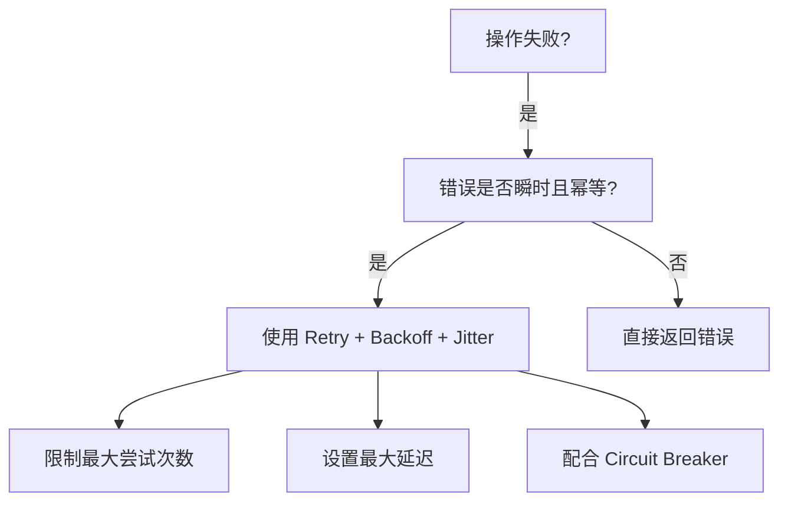
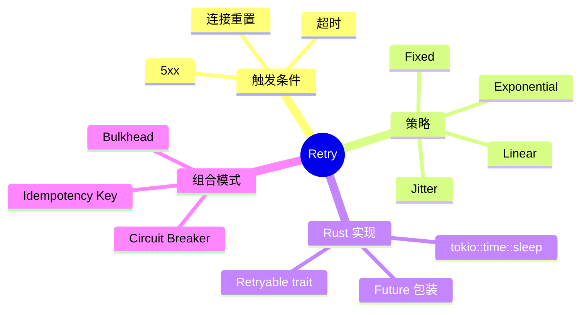

> **内容分级**: [专家级]

# 重试模式（Retry）

**EN**: Retry Pattern in Rust
**Summary**: Transparently re-execute failed operations that are likely to succeed on subsequent attempts, using backoff and jitter to avoid thundering herds.

> **Rust 版本**: 1.97.0+ (Edition 2024)
> **Bloom 层级**: L5-L6
> **权威来源**: 本文件为 `concept/` 权威页。
> **定位**: 将 transient-fault handling 的 Retry 模式与 Rust 的 `Future`、trait、错误类型对齐，实现可组合、可观测的重试中间件。
> **前置概念**: [Error Handling](../../01_foundation/08_error_handling/01_error_handling_basics.md) · [Async](../../03_advanced/01_async/01_async.md) · [Circuit Breaker](26_circuit_breaker.md) · [Paradigm Matrix](../../05_comparative/00_paradigms/01_paradigm_matrix.md)
> **后置概念**: [Bulkhead](27_bulkhead.md) · [Saga](29_saga.md)

---

> **来源 / Provenance**:
> [Microsoft — Cloud Design Patterns: Retry](https://learn.microsoft.com/en-us/azure/architecture/patterns/retry) ·
> [AWS — Retry pattern](https://docs.aws.amazon.com/prescriptive-guidance/latest/cloud-design-patterns/retry-pattern.html) ·
> [Vaucher et al. — A Comprehensive Empirical Study on Transient Fault Handling](https://doi.org/10.1145/3377811.3380415) ·
> [Exponential Backoff and Jitter (AWS Blog)](https://aws.amazon.com/blogs/architecture/exponential-backoff-and-jitter/) ·
> [docs.rs — backoff](https://docs.rs/backoff) ·
> [docs.rs — tokio-retry](https://docs.rs/tokio-retry)

---

## 一、权威定义

**重试（Retry）**: 当操作因瞬时故障（transient fault）失败时，按预定策略重新执行该操作。典型策略包括：

- **固定间隔（Fixed Interval）**: 每次等待固定时间。
- **指数退避（Exponential Backoff）**: 等待时间按指数增长。
- **指数退避 + 抖动（Jitter）**: 在退避基础上加入随机扰动，避免多个客户端同时重试。

> **来源**: [Microsoft — Retry pattern](https://learn.microsoft.com/en-us/azure/architecture/patterns/retry) · [AWS — Retry pattern](https://docs.aws.amazon.com/prescriptive-guidance/latest/cloud-design-patterns/retry-pattern.html)

---

## 二、属性矩阵

| 策略 | 公式 | 优点 | 缺点 |
|:---|:---|:---|:---|
| **Fixed** | `delay = base` | 简单可预测 | 易造成重试风暴 |
| **Linear** | `delay = base * attempt` | 比固定间隔更温和 | 仍可能同步 |
| **Exponential** | `delay = base * 2^attempt` | 快速降低负载 | 最大值需限制 |
| **Exponential + Jitter** | `delay = rand(0, base * 2^attempt)` | 打散重试峰值 | 实现稍复杂 |

---

## 三、Rust 实现

```rust,ignore
use std::future::Future;
use std::time::Duration;
use rand::Rng;
use tokio::time::sleep;

pub struct RetryPolicy {
    max_attempts: u32,
    base_delay: Duration,
    max_delay: Duration,
}

impl RetryPolicy {
    pub async fn execute<F, Fut, T, E>(&self, mut f: F) -> Result<T, E>
    where
        F: FnMut() -> Fut,
        Fut: Future<Output = Result<T, E>>,
    {
        let mut attempt = 0;
        loop {
            match f().await {
                Ok(v) => return Ok(v),
                Err(e) if attempt + 1 >= self.max_attempts => return Err(e),
                Err(_) => {
                    let delay = self.compute_delay(attempt);
                    sleep(delay).await;
                    attempt += 1;
                }
            }
        }
    }

    fn compute_delay(&self, attempt: u32) -> Duration {
        let exp = self.base_delay * 2_u32.pow(attempt);
        let capped = exp.min(self.max_delay);
        let jitter_ms = rand::thread_rng().gen_range(0..capped.as_millis() as u64 + 1);
        Duration::from_millis(jitter_ms)
    }
}

// 仅对可重试错误启用重试
pub trait Retryable {
    fn is_retryable(&self) -> bool;
}
```

---

## 四、关系

- **Retry ↔ Circuit Breaker**: 重试解决瞬时故障；断路器解决持续故障。组合时，重试应发生在断路器 Closed 状态下。
- **Retry ↔ Idempotency**: 重试必须配合幂等键，避免副作用重复发生。
- **Retry ↔ Bulkhead**: 重试次数与并发必须受舱壁容量约束，防止重试风暴。

---

## 五、反例与边界

### 反例：无条件重试所有错误

```rust,ignore
// ❌ 错误：对业务错误也重试
for _ in 0..3 {
    if create_user(email).await.is_err() { /* retry */ }
}
```

**修正**: 仅对 `is_retryable()` 为 true 的错误（超时、连接重置、5xx）重试；4xx 业务错误应直接返回。

### 边界：重试放大延迟

每次重试都会增加尾部延迟。对于用户同步请求，应限制 `max_attempts` 并设置较短的 `max_delay`。

---

## ⚠️ 实测反例（rustc 1.99.1 + 本机 Windows 实跑，2026-10-19）

### 反例 1：指数退避的 `2_u32.pow(attempt)` 是延迟炸弹——debug 崩、release 静默归零

上文 §三 的 `compute_delay` 使用 `self.base_delay * 2_u32.pow(attempt)`。本机把 attempt 拉到 0..34 实跑同一表达式：

```rust,should_panic
use std::time::Duration;
fn compute_delay(base: Duration, attempt: u32) -> Duration {
    let exp = base * 2_u32.pow(attempt);   // 页内示例原表达式
    exp.min(Duration::from_secs(30))
}
fn main() {
    let base = Duration::from_millis(1);
    for a in 0..34u32 {
        let d = compute_delay(base, a);
        println!("attempt {a}: {:?}", d.as_millis());
    }
}
```

**debug 构建实测**（attempt=32 处）：

```text
thread 'main' panicked at library/core/src/num/mod.rs:1290:5:
attempt to exponentiate with overflow
```

**`rustc -O` 构建实测**：不 panic，`2^32` 按 wrapping 语义归零——

```text
attempt 31: 30000
attempt 32: 0        ← 退避直接变 0ms
attempt 33: 0        ← 之后每次重试都是零延迟
```

同一份代码，两种 profile 给出两种故障模式：开发期 panic 崩溃，生产期退避**静默失效为 0ms**，恰好落在最需要退避的长时间故障场景（attempt 累积超过 31）。这正是 §五「重试放大延迟」边界的镜像反例——不是延迟过大，而是退避机制本身在最坏路径上消失。

**修正**：指数用 saturating 语义并限制在 `u32::BITS` 内：

```rust
use std::time::Duration;
fn compute_delay_safe(base: Duration, attempt: u32) -> Duration {
    let shift = attempt.min(31);                    // 越界前先封顶
    let exp = base.saturating_mul(2_u32.pow(shift));
    exp.min(Duration::from_secs(30))
}
fn main() {
    let base = Duration::from_millis(1);
    for a in [0u32, 15, 31, 32, 100] {
        println!("attempt {a}: {:?}", compute_delay_safe(base, a).as_millis());
    }
}
```

实测输出（debug 与 `-O` 完全一致）：`0: 1 / 15: 30000（32768 被 max_delay 封顶） / 31: 30000 / 32: 30000 / 100: 30000`——退避永不归零。

### 反例 2：重试放大了非幂等副作用（错误路径也会留下副作用）

§五 说「重试必须配合幂等键」。本机实测一个「副作用先于校验」的常见 API 形态，看重试到底放大了什么：

```rust
struct Cart { items: Vec<u32> }
impl Cart {
    fn apply_coupon(&mut self, c: u32) -> Result<(), String> {
        self.items.push(c);                       // 副作用先发生（真实 bug 常见形态）
        if c > 100 { return Err("coupon too large".into()); }
        Ok(())
    }
}
fn main() {
    let mut cart = Cart { items: vec![] };
    for attempt in 0..3 {
        match cart.apply_coupon(999) {
            Ok(()) => break,
            Err(e) => println!("attempt {attempt}: err={e}, items.len()={}", cart.items.len()),
        }
    }
    println!("最终 items={:?} len={}", cart.items, cart.items.len());
}
```

实测输出（exit 0）：

```text
attempt 0: err=coupon too large, items.len()=1
attempt 1: err=coupon too large, items.len()=2
attempt 2: err=coupon too large, items.len()=3
最终 items=[999, 999, 999] len=3
```

三次「失败」的调用在状态里留下了三条记录。对 `Err` 分支无差别重试时，**每一次失败重试都完整执行了副作用半程**——这在真实系统对应「下单失败重试 3 次 → 用户被扣款 3 次」。结论：重试的前置条件不是「错误是瞬时的」，而是「操作在错误路径上也是幂等的」，或者副作用被推到校验之后/事务提交点之后。

---

## 六、决策树



---

## 七、思维导图



---

## ⚠️ 实测反例（rustc 1.99.1 实运行，2026-10-19）：retry 的隐藏前提是「操作幂等」——非幂等副作用重试 3 次就执行 3 次，类型系统对此零预警

```rust
use std::collections::HashSet;
fn main() {
    // naive retry: 每次重试都真实执行扣款副作用
    let mut bank = 50i32;
    for _ in 0..3 { bank -= 100; }
    println!("1 naive retry on non-idempotent charge: balance = {} (扣款3次, 共300)", bank);
    // 幂等版: 同一 req_id 的三次重试, 幂等键去重
    let mut bank2 = 50i32; let mut applied = HashSet::new();
    for _attempt in 0..3 { if applied.insert(7u32) { bank2 -= 100; } }
    println!("2 idempotency-keyed (req_id=7 retried 3x): balance = {} (只扣1次, 共100)", bank2);
}
```

实运行输出：

```text
1 naive retry on non-idempotent charge: balance = -250 (扣款3次, 共300)
2 idempotency-keyed (req_id=7 retried 3x): balance = -50 (只扣1次, 共100)
```

口径：`Result` 只告诉你「这次失败了」，不告诉你「失败前副作用已经落地多少」。重试循环对网络超时常是安全的，对「扣款成功但响应丢失」场景就是重复扣款——`Err` 分支与「远端已执行」在 Rust 类型层不可区分（这正是本页 §2 讨论的 retry 分类学的失效面）。合规做法是把幂等键（req_id）作为操作的一部分传下去，让「至少一次」投递语义在接收侧折叠成「恰好一次」；`exponential_backoff`、`retry_when` 等策略参数全部不改变这一点。支付/下单类系统的重试预算必须先回答幂等性，再谈退避算法——顺序反了，退避只是把重复扣款排得更从容。

---

## 八、权威来源索引

- Microsoft. "Retry pattern." *Azure Architecture Center*. [https://learn.microsoft.com/en-us/azure/architecture/patterns/retry](https://learn.microsoft.com/en-us/azure/architecture/patterns/retry)
- AWS. "Retry pattern." *Prescriptive Guidance*. [https://docs.aws.amazon.com/prescriptive-guidance/latest/cloud-design-patterns/retry-pattern.html](https://docs.aws.amazon.com/prescriptive-guidance/latest/cloud-design-patterns/retry-pattern.html)
- Vaucher, J. et al. "A Comprehensive Empirical Study on Transient Fault Handling." *ICPE 2020*. [https://doi.org/10.1145/3377811.3380415](https://doi.org/10.1145/3377811.3380415)
- AWS. "Exponential Backoff and Jitter." *Architecture Blog*. [https://aws.amazon.com/blogs/architecture/exponential-backoff-and-jitter/](https://aws.amazon.com/blogs/architecture/exponential-backoff-and-jitter/)

> **文档版本**: 1.0 ｜ **最后更新**: 2026-07-31 ｜ **状态**: ✅ 新建权威页

## 国际化权威来源补充（International Authority Sources）

- https://dl.acm.org/doi/book/10.5555/186897
- https://rust-unofficial.github.io/patterns/
- [The Rust Programming Language — Error Handling](https://doc.rust-lang.org/book/ch09-00-error-handling.html)
- [Rust Reference — Traits](https://doc.rust-lang.org/reference/items/traits.html)
- [The Rust Programming Language — Closures](https://doc.rust-lang.org/book/ch13-01-closures.html)
