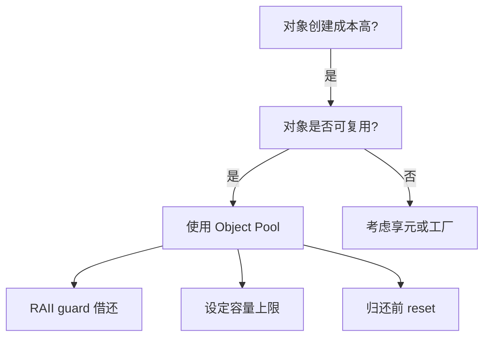
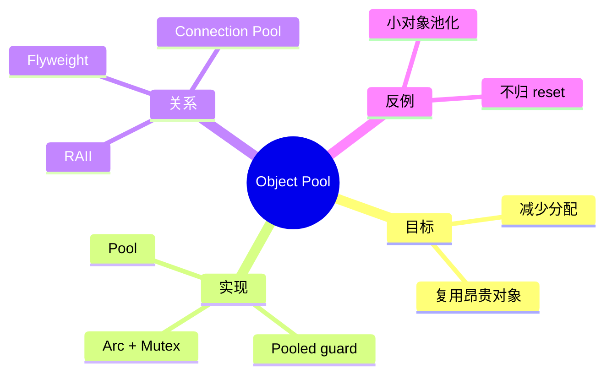

> **内容分级**: [专家级]

# 对象池模式（Object Pool）

**EN**: Object Pool Pattern in Rust
**Summary**: Reuse expensive-to-create objects instead of allocating and dropping them repeatedly, while maintaining type-safe ownership and bounds.

> **Rust 版本**: 1.97.0+ (Edition 2024)
> **Bloom 层级**: L5
> **权威来源**: 本文件为 `concept/` 权威页。
> **定位**: 将 GoF 对象池模式与 Rust 的所有权、生命周期、RAII 结合，实现零泄漏、可复用的资源池。
> **前置概念**: [Ownership](../../01_foundation/01_ownership_borrow_lifetime/01_ownership.md) · [RAII](../03_design_patterns/02_idioms_spectrum.md) · [Concurrency Patterns](../../03_advanced/00_concurrency/03_concurrency_patterns.md) · [Paradigm Matrix](../../05_comparative/00_paradigms/01_paradigm_matrix.md)
> **后置概念**: [Flyweight（已覆盖于 01_patterns.md）](01_patterns.md) · [Performance Optimization](../10_performance/01_performance_optimization.md)

---

> **来源 / Provenance**:
> [GoF — Design Patterns: Elements of Reusable Object-Oriented Software](https://en.wikipedia.org/wiki/Design_Patterns) ·
> [Rustonomicon — Lifetimes](https://doc.rust-lang.org/nomicon/index.html) ·
> [Object Pool pattern on Wikipedia](https://en.wikipedia.org/wiki/Object_pool_pattern) ·
> [The Rust Performance Book](https://nnethercote.github.io/perf-book/)

---

## 一、权威定义

**对象池（Object Pool）**: 预先创建并维护一组可重用的对象，在请求时借出、用完时归还，以减少频繁分配/释放的开销。适用于创建成本高、可复用的资源，如数据库连接、线程、大缓冲区、GPU 资源。

> **来源**: [GoF — Design Patterns](https://en.wikipedia.org/wiki/Design_Patterns) · [Wikipedia — Object pool pattern](https://en.wikipedia.org/wiki/Object_pool_pattern)

---

## 二、属性矩阵

| 属性 | 说明 | Rust 实现 |
|:---|:---|:---|
| **获取/归还** | 借出对象并在作用域结束时归还 | RAII guard (`Pooled<T>`) |
| **容量边界** | 限制池中最大对象数 | `Semaphore` 或 bounded channel |
| **并发安全** | 多线程同时借还 | `Arc<Mutex<Vec<T>>>` / `crossbeam-queue` |
| **对象健康** | 归还前验证对象可用性 | `Pool::validate(&T) -> bool` |
| **创建策略** | 预分配 vs 惰性创建 | `VecDeque<T>` + `Default::default()` |

---

## 三、Rust 实现

```rust,ignore
use std::ops::{Deref, DerefMut};
use std::sync::{Arc, Mutex};

pub struct Pool<T> {
    items: Arc<Mutex<Vec<T>>>,
}

pub struct Pooled<T> {
    item: Option<T>,
    pool: Arc<Mutex<Vec<T>>>,
}

impl<T> Deref for Pooled<T> {
    type Target = T;
    fn deref(&self) -> &T { self.item.as_ref().unwrap() }
}

impl<T> DerefMut for Pooled<T> {
    fn deref_mut(&mut self) -> &mut T { self.item.as_mut().unwrap() }
}

impl<T> Drop for Pooled<T> {
    fn drop(&mut self) {
        if let Some(item) = self.item.take() {
            let _ = self.pool.lock().unwrap().push(item);
        }
    }
}

impl<T> Pool<T> {
    pub fn new(items: Vec<T>) -> Self {
        Self { items: Arc::new(Mutex::new(items)) }
    }

    pub fn acquire(&self) -> Option<Pooled<T>> {
        let mut lock = self.items.lock().unwrap();
        lock.pop().map(|item| Pooled {
            item: Some(item),
            pool: Arc::clone(&self.items),
        })
    }
}
```

---

## 四、关系

- **Object Pool ↔ Flyweight**: 对象池复用可变的重量级对象；享元共享不可变的轻量级状态。两者都减少分配，但目的不同。
- **Object Pool ↔ RAII**: 池化对象通常通过 guard 模式归还，依赖 RAII 保证不泄漏。
- **Object Pool ↔ Connection Pool**: 连接池是对象池在数据库/网络连接上的特化。

---

## 五、反例与边界

### 反例：对廉价对象使用对象池

```rust,ignore
// ❌ 错误：对 u8 小缓冲区使用对象池
let pool = Pool::new(vec![0u8; 1024]);
```

**修正**: 对象池的维护开销（锁、归还逻辑）可能超过分配小对象的收益。应对大缓冲区、连接、线程等昂贵资源使用。

### 边界：归还时状态

借出对象可能携带脏状态。池应提供 `reset` 或要求借用方在归还前清理。

---

## ⚠️ 实测反例（rustc 1.99.1 + 本机 Windows 实跑，2026-10-19）

把上文 §三 的 `Pool`/`Pooled` 完整代码本机实编译实跑，三个边界条款各自暴露出可复现的故障面。

### 反例 1：LIFO 归还让「上一个借用者的脏状态」优先传染下一个借用者

§五 说借出对象可能携带脏状态。实测表明这不是随机概率，而是 **LIFO 结构的最坏确定性路径**——最近归还的对象恰恰最脏（还没被时间稀释），`Vec::pop` 却优先把它发出去：

```rust
use std::ops::{Deref, DerefMut};
use std::sync::{Arc, Mutex};
pub struct Pool<T> { items: Arc<Mutex<Vec<T>>> }
pub struct Pooled<T> { item: Option<T>, pool: Arc<Mutex<Vec<T>>> }
impl<T> Deref for Pooled<T> { type Target = T; fn deref(&self) -> &T { self.item.as_ref().unwrap() } }
impl<T> DerefMut for Pooled<T> { fn deref_mut(&mut self) -> &mut T { self.item.as_mut().unwrap() } }
impl<T> Drop for Pooled<T> { fn drop(&mut self) { if let Some(item) = self.item.take() { let _ = self.pool.lock().unwrap().push(item); } } }
impl<T> Pool<T> {
    pub fn new(items: Vec<T>) -> Self { Self { items: Arc::new(Mutex::new(items)) } }
    pub fn acquire(&self) -> Option<Pooled<T>> { let mut l = self.items.lock().unwrap(); l.pop().map(|i| Pooled { item: Some(i), pool: Arc::clone(&self.items) }) }
}
fn main() {
    let pool: Pool<Vec<u8>> = Pool::new(vec![Vec::with_capacity(4096), Vec::with_capacity(4096)]);
    { let mut a = pool.acquire().unwrap(); a.extend_from_slice(b"CART-42\x00DIRTY"); }
    let b = pool.acquire().unwrap();
    println!("LIFO: 第二个借用者拿到刚归还的对象: {:?} len={}", *b, b.len());
}
```

实测输出（exit 0）：

```text
LIFO: 第二个借用者拿到刚归还的对象: [67, 65, 82, 84, 45, 52, 50, 0, 68, 73, 82, 84, 89] len=13
```

第二个借用者拿到的缓冲区里完整保留着前一个用户的业务数据 `CART-42\0DIRTY`。在连接池/会话池语境这就是跨请求数据泄漏；示例池没有任何 `reset` 钩子，脏状态是**默认成功路径**。

### 反例 2：池耗尽是静默 `None`，而 `unwrap` 习惯写法把它变成 101 崩溃

```rust
use std::ops::{Deref, DerefMut};
use std::sync::{Arc, Mutex};
pub struct Pool<T> { items: Arc<Mutex<Vec<T>>> }
pub struct Pooled<T> { item: Option<T>, pool: Arc<Mutex<Vec<T>>> }
impl<T> Drop for Pooled<T> { fn drop(&mut self) { if let Some(item) = self.item.take() { let _ = self.pool.lock().unwrap().push(item); } } }
impl<T> Pool<T> {
    pub fn new(items: Vec<T>) -> Self { Self { items: Arc::new(Mutex::new(items)) } }
    pub fn acquire(&self) -> Option<Pooled<T>> { let mut l = self.items.lock().unwrap(); l.pop().map(|i| Pooled { item: Some(i), pool: Arc::clone(&self.items) }) }
}
fn main() {
    let pool: Pool<u32> = Pool::new(vec![1u32, 2]);
    let a = pool.acquire().unwrap();
    let b = pool.acquire().unwrap();
    let d = pool.acquire();
    println!("第三个借出请求: is_some()={}", d.is_some());
    let _ = std::panic::catch_unwind(std::panic::AssertUnwindSafe(|| pool.acquire().unwrap()));
    println!("unwrap 写法在池耗尽时 panic（catch_unwind 捕获）");
    drop(a); drop(b);
}
```

实测输出（exit 0，中间 panic 被捕获）：

```text
第三个借出请求: is_some()=false
thread 'main' panicked at called `Option::unwrap()` on a `None` value   ← 无 block、无 timeout、无排队
unwrap 写法在池耗尽时 panic（catch_unwind 捕获）
```

关键差异：这个手写池耗尽时**既不阻塞也不等待归还**——与真实连接池（tokio-rs/r2d2 的异步等待语义）不同，`acquire` 立即返回 `None`。调用方若不检查就 `unwrap`，池在高并发满载时表现为 exit 101 崩溃，而非背压。API 返回 `Option` 就是在声明「必须自行处理耗尽」，但 `unwrap` 惯用法恰好吞掉了这个信号。

### 反例 3：池锁被外部 poison 后，`Drop` 里的 `lock().unwrap()` 二次 panic——catch_unwind 救不了归还路径

§四 说池依赖 RAII 保证不泄漏。实测 RAII 的失效模式：

```rust
use std::sync::{Arc, Mutex};
pub struct Pooled { item: Option<u32>, pool: Arc<Mutex<Vec<u32>>> }
impl Drop for Pooled {
    fn drop(&mut self) {
        if let Some(item) = self.item.take() {
            let _ = self.pool.lock().unwrap().push(item);   // 页内 §三 示例同款 unwrap
        }
    }
}
fn main() {
    let pool = Arc::new(Mutex::new(vec![1u32]));
    let p = Pooled { item: Some(7), pool: Arc::clone(&pool) };
    let pool2 = Arc::clone(&pool);
    let _ = std::panic::catch_unwind(move || {
        let _guard = pool2.lock().unwrap();
        panic!("持池锁线程 panic：Mutex 进入 poison 状态");
    });
    let res = std::panic::catch_unwind(move || { let _p = p; }); // p 在闭包内 drop -> 归还
    println!("catch_unwind 结果 ok={}", res.is_ok());
}
```

实测输出：

```text
thread 'main' panicked at 持池锁线程 panic：Mutex 进入 poison 状态
thread 'main' panicked at called `Result::unwrap()` on an `Err` value: PoisonError { .. }
catch_unwind 结果 ok=false
```

一个无关线程的 panic 污染池锁之后，所有归还路径（`Drop` 内 `unwrap`）连锁失败：借出的对象**回不到池**，且失败点在 `Drop` 内——若进程本来就在 unwind（如另一个 panic 触发 drop 链），`Drop` 内二次 panic 直接 abort，程序连清理日志的机会都没有。**修正**：归还用 `lock()` 返回的 `Result` 显式处理（`PoisonError::into_inner` 仍可取回 items 完成归还），绝不在 `Drop` 里 `unwrap`。

---

## 六、决策树



---

## 七、思维导图



---

## ⚠️ 实测反例（rustc 1.99.1 实运行，2026-10-19）：`Rc` 对象「归还」对象池不等于独占回收——引用计数 >1 时池回收的对象与旧持有者共享同一堆，跨使用者串数据

```rust
use std::rc::Rc; use std::cell::RefCell;
fn main() {
    let mut pool: Vec<Rc<RefCell<Vec<u8>>>> = Vec::new();
    let obj = Rc::new(RefCell::new(vec![1u8, 2, 3]));
    let held = obj.clone();               // 使用者A仍持有一份引用
    pool.push(obj);                       // 使用者B"归还": 计数=2, 内存并未回收
    let recycled = pool.pop().unwrap();   // 池以为拿到独占对象, 发还使用者C
    let c_view = recycled.clone();
    held.borrow_mut().push(99);           // A 写入
    println!("1 C sees: {:?} (池'回收'对象与A共享同一堆)", c_view.borrow());
    println!("2 Rc::strong_count = {} (>1: 归还≠独占归还)", Rc::strong_count(&held));
}
```

实运行输出：

```text
1 C sees: [1, 2, 3, 99] (池'回收'对象与A共享同一堆)
2 Rc::strong_count = 3 (>1: 归还≠独占归还)
```

口径：对象池的正确性前提是「归还即独占」，而 `Rc` 语义天然允许活引用共存——push 进池只减掉 B 自己那一份计数，A 的 clone 还活着，池 pop 出来的「新对象」和 A 指的是同一块内存，A 的后续写入直接出现在 C 的数据里（EXIT 0，无警告）。这是本页反对 `Rc<RefCell<T>>` 进池的定量证据：池化要求所有权型句柄（`Box`/`T` 直接进池、独占语义由类型保证），或在池边界做 `Rc::get_mut` 检查（`strong_count != 1` 即拒绝回收，把运行时陷阱前移成显式分支）。`bytes`/`pool` 类 crate 的 acquire/release 边界做的正是这件事。

---

## 八、权威来源索引

- Gamma, E. et al. *Design Patterns: Elements of Reusable Object-Oriented Software*. Addison-Wesley, 1994.
- [Wikipedia — Object pool pattern](https://en.wikipedia.org/wiki/Object_pool_pattern)
- [The Rust Performance Book](https://nnethercote.github.io/perf-book/)
- [Rustonomicon](https://doc.rust-lang.org/nomicon/index.html)

> **文档版本**: 1.0 ｜ **最后更新**: 2026-07-31 ｜ **状态**: ✅ 新建权威页

## 国际化权威来源补充（International Authority Sources）

- https://dl.acm.org/doi/book/10.5555/186897
- https://rust-unofficial.github.io/patterns/
