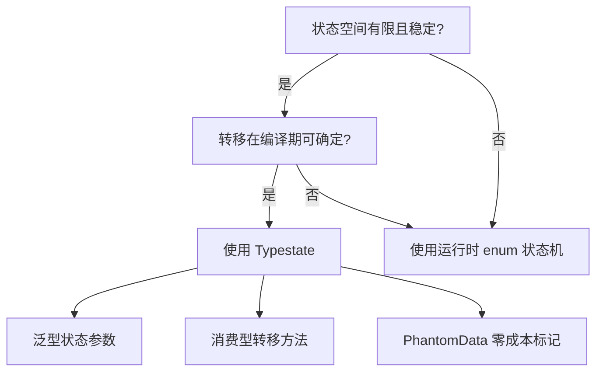

> **内容分级**: [专家级]

# 类型状态模式深度剖析（Typestate Deep Dive）

**EN**: Typestate Pattern Deep Dive
**Summary**: Encode protocol states as types so that illegal state transitions become compile-time errors, leveraging Rust's ownership and generics.

> **Rust 版本**: 1.97.0+ (Edition 2024)
> **Bloom 层级**: L3-L5
> **权威来源**: 本文件为 `concept/` 权威页。
> **定位**: 在 `01_patterns.md` 与 `02_idioms_spectrum.md` 的 Typestate 基础上，提供更系统的形式化定义、变型控制、与运行时状态机的对比，以及生产级实现策略。
> **前置概念**: [Type System](../../01_foundation/02_type_system/01_type_system.md) · [Generics](../../02_intermediate/01_generics/01_generics.md) · [PhantomData](../../02_intermediate/01_generics/03_type_level_programming.md) · [Ownership](../../01_foundation/01_ownership_borrow_lifetime/01_ownership.md) · [Language Semantic Model Matrix](../../05_comparative/00_paradigms/05_language_semantic_model_matrix.md)
> **后置概念**: [Builder](01_patterns.md) · [State Machine](01_patterns.md) · [Idioms Spectrum](02_idioms_spectrum.md)

---

> **来源 / Provenance**:
> [Strom & Yemini 1986 — Typestate: A Programming Language Concept for Enhancing Software Reliability](https://doi.org/10.1145/512644.512659) ·
> [Rust Design Patterns — Typestate](https://rust-unofficial.github.io/patterns/typestate.html) ·
> [Wikipedia — Typestate analysis](https://en.wikipedia.org/wiki/Typestate_analysis) ·
> [TRPL §10 — Generic Types](https://doc.rust-lang.org/book/ch10-00-generics.html)

---

## 一、权威定义

**Typestate（类型状态）**: 将对象的可接受状态空间编码进类型参数；状态转移只能通过返回新类型实例的方法完成。非法转移在编译期被拒绝。

形式化：设对象 `O<S>` 的状态集合为 `S ∈ {S₁, S₂, ..., Sₙ}`，合法转移为偏函数 `δ: O<Sᵢ> → O<Sⱼ>`。未定义的 `δ` 对应的方法不存在，因此调用非法转移会在类型检查阶段失败。

> **来源**: [Strom & Yemini 1986](https://doi.org/10.1145/512644.512659) · [Rust Design Patterns — Typestate](https://rust-unofficial.github.io/patterns/typestate.html)

---

## 二、属性矩阵

| 维度 | Typestate | 运行时状态机 |
|:---|:---|:---|
| **状态检查时机** | 编译期 | 运行期 |
| **运行时开销** | 零成本 | 分支/查表开销 |
| **状态空间大小** | 适合中小型（<20） | 可任意大 |
| **错误反馈** | `E0599` 等方法不存在错误 | panic / 返回 Err |
| **典型 Rust 工具** | 泛型 + `PhantomData` + 消费型 `self` | `enum` + `match` |
| **动态多态** | 不支持（静态分发） | 支持 `dyn State` |

---

## 三、Rust 实现

### 3.1 基础 Typestate

```rust
struct Disconnected;
struct Connected;

struct TcpClient<State> {
    addr: String,
    _state: std::marker::PhantomData<State>,
}

impl TcpClient<Disconnected> {
    pub fn new(addr: impl Into<String>) -> Self {
        Self { addr: addr.into(), _state: std::marker::PhantomData }
    }

    pub fn connect(self) -> TcpClient<Connected> {
        TcpClient {
            addr: self.addr,
            _state: std::marker::PhantomData,
        }
    }
}

impl TcpClient<Connected> {
    pub fn send(&self, msg: &[u8]) {
        // 发送逻辑
    }

    pub fn disconnect(self) -> TcpClient<Disconnected> {
        TcpClient {
            addr: self.addr,
            _state: std::marker::PhantomData,
        }
    }
}

fn main() {
    let client = TcpClient::new("127.0.0.1:8080");
    let client = client.connect();
    client.send(b"hello");
    let _ = client.disconnect();
    // client.send(b"world"); // ❌ 编译错误：Disconnected 状态无 send 方法
}
```

### 3.2 带可变性的 Typestate

```rust,ignore
struct Open;
struct Closed;

struct FileHandle<State> {
    path: String,
    _state: std::marker::PhantomData<State>,
}

impl FileHandle<Closed> {
    fn open(path: &str) -> FileHandle<Open> {
        FileHandle { path: path.into(), _state: std::marker::PhantomData }
    }
}

impl FileHandle<Open> {
    fn read(&mut self) -> Vec<u8> { vec![] }
    fn close(self) -> FileHandle<Closed> {
        FileHandle { path: self.path, _state: std::marker::PhantomData }
    }
}
```

---

## 四、关系

- **Typestate ↔ Builder**: 类型状态 Builder 是 Typestate 最常见的应用；必填字段通过状态类型强制。
- **Typestate ↔ State Machine**: Typestate 是编译期状态机；当状态数量大或需要动态插件时，应改用运行时 `enum` 状态机。
- **Typestate ↔ PhantomData**: `PhantomData` 携带状态信息而不占内存，是 Typestate 的零成本基石。

---

## 五、反例与边界

### 反例：状态爆炸

```rust,ignore
// ❌ 错误：把 50 个业务状态全部编码为类型参数
struct Order<S1, S2, S3, S4, S5, S6, S7, S8, S9, S10>;
```

**修正**: 当状态数量超过 15-20 或转移图高度动态时，改用运行时状态机。

### 边界：Typestate 不替代验证

Typestate 保证「不可调用非法转移方法」，但不能替代业务值的运行时验证（如金额 > 0）。

---

## ⚠️ 实测反例（rustc 1.99.1 实编译，2026-10-19）

Typestate 的安全保证完全取决于 impl 块怎么写。本机用 `File<Open>/File<Closed>` 三段最小复现，展示同一套状态类型在三种写法下的截然不同结果。

### 反例 1：把方法写进泛型 `impl<S: Marker>` —— typestate 静默坍缩，编译与运行全绿但护栏为零

§3.1 的正确写法是**每个状态一个专属 impl 块**。最常见的错误写法是把方法提升到泛型 impl：

```rust
use std::marker::PhantomData;
trait Marker { fn id() -> &'static str; }
struct Open; impl Marker for Open { fn id() -> &'static str { "Open" } }
struct Closed; impl Marker for Closed { fn id() -> &'static str { "Closed" } }
struct File<S: Marker> { data: Vec<u8>, _s: PhantomData<S> }
impl<S: Marker> File<S> {
    // ❌ 泛型 impl：不区分状态，所有状态都拿到全部方法
    fn read(&self) -> Vec<u8> { println!("read allowed in state {}", S::id()); self.data.clone() }
}
fn main() {
    let f = File::<Open> { data: vec![1, 2], _s: PhantomData };
    println!("未关闭状态 read 成功: {:?}", f.read());
}
```

**实编译通过、实跑输出（exit 0）**：

```text
read allowed in state Open
未关闭状态 read 成功: [1, 2]
```

没有任何编译错误、没有 clippy 警告（只有一个 `Closed` 未构造的 dead_code 提示）。这是 typestate 最危险的失效模式：**模式看起来是 typestate（有 Marker、有 PhantomData、有状态参数），护栏却完全不存在**。泛型 impl 让 `read` 对每个状态可见，编译器从此永远抓不到「未连接就发送/未关闭就读」这类错误。

### 反例 2：正确写法下跨状态调用被 E0599 硬拒——且诊断直接指名正确状态

把方法放回状态专属 impl（§3.1 写法），同样的调用被编译期拒绝：

```rust,compile_fail
use std::marker::PhantomData;
trait Marker {}
struct Open; impl Marker for Open {}
struct Closed; impl Marker for Closed {}
struct File<S: Marker> { data: Vec<u8>, _s: PhantomData<S> }
impl File<Closed> { fn read(&self) -> Vec<u8> { self.data.clone() } }
impl File<Open> { fn close(self) -> File<Closed> { File { data: self.data, _s: PhantomData } } }
fn main() {
    let f = File::<Open> { data: vec![1, 2], _s: PhantomData };
    let _ = f.read(); // 未 close 就 read
}
```

**实测 rustc 1.99.1 输出（E0599）**：

```text
error[E0599]: no method named `read` found for struct `File<Open>` in the current scope
  |
5 | struct File<S: Marker> { data: Vec<u8>, _s: PhantomData<S> }
  | ---------------------- method `read` not found for this struct
10|     let _ = f.read(); // 未 close 就 read
  |               ^^^^ method not found in `File<Open>`
  |
  = note: the method was found for `File<Closed>`
```

值得注意的诊断细节：`note: the method was found for File<Closed>` 直接告诉调用方「方法存在，但你在错误的状态上」——这是与反例 1 的本质区别，护栏存在且诊断可操作。附带效果：`Open` 上调不到的每个方法名都变成一次编译期事故报告。

### 反例 3：状态标记漏 impl trait —— 错误不在调用点，而在 impl 块本身（E0277 双位置）

状态类型 `struct Open;` 忘了 `impl Marker for Open {}` 时，报错点出乎许多人的预料——不在 `main`，而在你的专属 impl 块上，且一处语法位置报两条：

```rust,compile_fail
use std::marker::PhantomData;
trait Marker {}
struct Open; // ❌ 忘 impl Marker
struct Closed; impl Marker for Closed {}
struct File<S: Marker> { data: Vec<u8>, _s: PhantomData<S> }
impl File<Open> { fn read(&self) -> Vec<u8> { self.data.clone() } }
fn main() {}
```

**实测输出（两条 E0277，分别在 `impl File<Open>` 与 `fn read` 位置）**：

```text
error[E0277]: the trait bound `Open: Marker` is not satisfied
7 | impl File<Open> { fn read(&self) -> Vec<u8> ...
  |      ^^^^^^^^^^ unsatisfied trait bound
  |
help: the trait `Marker` is not implemented for `Open`
3 | struct Open; // ❌ 忘 impl Marker
  | ^^^^^^^^^^^
help: the trait `Marker` is implemented for `Closed`
```

诊断质量很高：同时给出「哪个类型缺哪个 trait」「trait 已为哪个类型实现」两个对照锚点。但它暴露了 Marker-bound 模式的维护成本——每新增一个状态类型都要记得 impl，漏掉的失败方式是「该状态的专属 impl 块整块编译失败」，大型状态机上报错可能一次爆几十条。实践上可用 `impl Marker for Open {}` 集中放在状态类型定义紧邻处，或给 Marker 提供默认方法（如反例 1 的 `id()`）让漏 impl 更早被 use 现场发现。

---

## 六、决策树



---

## 七、思维导图


---

## ⚠️ 实测反例（rustc 1.99.1 实编译，2026-10-19）：typestate 迁移消耗所有权——「用旧状态句柄」不是逻辑错而是 E0599，旧句柄在迁移那一刻已不复存在

```rust,compile_fail
struct Closed; struct Open;
struct Conn<S>(S);
impl Conn<Closed> { fn open(self) -> Conn<Open> { Conn(Open) } }
impl Conn<Open> { fn read(&self) -> u32 { 42 } fn close(self) -> Conn<Closed> { Conn(Closed) } }
fn main() {
    let c = Conn(Closed);
    let c2 = c.open();      // open(self) 消耗 c: c 此后不存在
    println!("{}", c.read()); // 拿"迁移前"的旧句柄做事
}
```

实编译报错：

```text
error[E0599]: no method named `read` found for struct `Conn<Closed>` in the current scope
```

口径：与运行时状态机（`enum State` + 每方法首行 assert）的本质区别在这里现形：运行时状态机允许「拿着旧对象继续调」，错在运行期才爆；typestate 的 `fn open(self)` 按值消耗句柄，迁移后旧句柄连变量都失效（借用检查器视其为 moved），于是「拿 Closed 句柄调 read」被拒之门外的方式是**方法根本不在该类型的动作集里**。E0599 的报错行指向 `Conn<Closed>`，编译器直接告诉你「这个状态没有这个动作」。代价侧（本页 §3 讨论）也随之可见：每次迁移必须写回 `let c = c.open()`，状态链是数据流的一部分，不能被旁路——想「跳状态」或「并行两个状态的句柄」都需要显式设计（复制状态机或通道），这正是 typestate 比 OOP 状态模式「多出来的纪律」，也正是它把一类整型 bug 从测试期搬到编译期的机制。

---

## 八、权威来源索引

- Strom, R. E. & Yemini, S. "Typestate: A Programming Language Concept for Enhancing Software Reliability." *IEEE TSE 1986*. [https://doi.org/10.1145/512644.512659](https://doi.org/10.1145/512644.512659)
- [Rust Design Patterns — Typestate](https://rust-unofficial.github.io/patterns/typestate.html)
- [Wikipedia — Typestate analysis](https://en.wikipedia.org/wiki/Typestate_analysis)
- Klabnik, S. & Nichols, C. *The Rust Programming Language*, Ch. 10. [https://doc.rust-lang.org/book/ch10-00-generics.html](https://doc.rust-lang.org/book/ch10-00-generics.html)

> **文档版本**: 1.0 ｜ **最后更新**: 2026-07-31 ｜ **状态**: ✅ 新建权威页

## 国际化权威来源补充（International Authority Sources）

- https://dl.acm.org/doi/book/10.5555/186897
