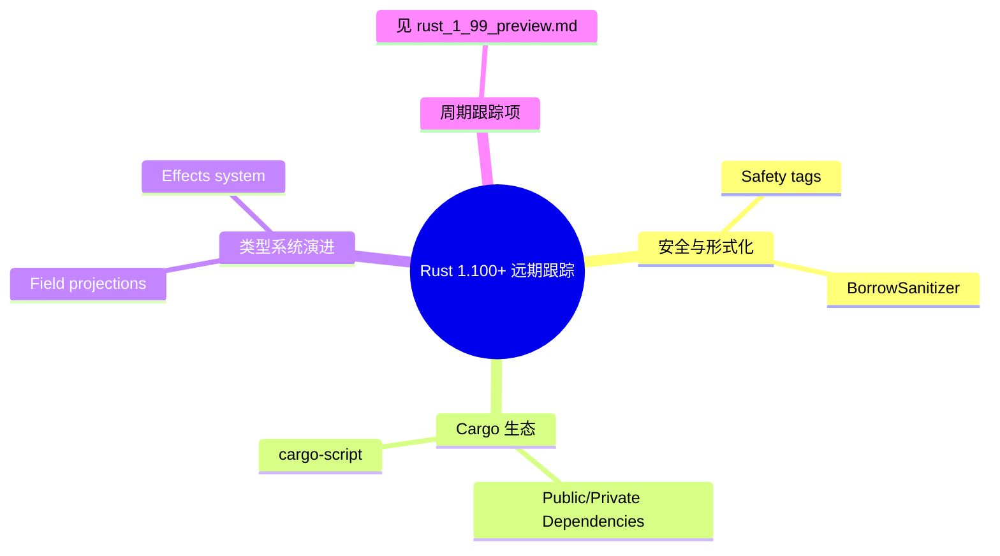

# Rust 1.100+ 远期特性预览

> **代码状态**: [跟踪级 — 持续更新]
>
> **EN**: Rust 1.100+ Long-Range Preview
> **Summary**: Rust 1.100 and beyond 的**远期跟踪**页：只登记 RFC 阶段 / 长期 nightly 的深水位特性（Safety Tags、BorrowSanitizer、Public/Private Dependencies、cargo-script、Field projections、Effects system 等）及其 RFC/设计进展；随 6 周周期滚动的当前周期跟踪（gen blocks、async drop、RTN、Specialization、TAIT、f16/f128、Portable SIMD 等）已统一收敛到 rust_1_99_preview.md。
> **Rust 版本**: 1.100.0 beta / 1.101.0 nightly（远期跟踪）
>
> **受众**: [专家]
> **Bloom 层级**: L2-L3
> **内容分级**: [实验级]
> **权威来源**: 本文件为 `concept/` 权威页（1.100+ **远期跟踪** canonical）。
> **Canonical 分工**: 本页 = **远期跟踪**（RFC 阶段 / 长期 nightly 特性，不绑定单一 6 周周期）；**当前周期滚动跟踪** = [`rust_1_99_preview.md`](rust_1_99_preview.md)（1.99.0 stable 后滚动为 1.100+ 周期跟踪）；1.100.0 **稳定特性权威汇总** = `rust_1_100_stabilized.md`（待 1.100.0 发布 stable 后建立）。
> **跟踪版本**: beta 1.100.0 / nightly 1.101.0（releases.rs 实测 2026-10-08：Stable 1.99.0 / Beta 1.100.0 / Nightly 1.101.0）
> **预计稳定时间**: **1.100.0 = 2026-11-12**（已于 2026-10-01 进入 beta）；本页登记的 RFC 阶段特性多数**不承诺**在 1.100 稳定
> **当前阶段**: 🧪 RFC / 设计 / prototype 阶段为主
> **Rust 属性标记**: `#[experimental]` `#[nightly_only]`
> **状态**: 特性集高度不确定，稳定时间和具体内容以官方发布为准
> **最后更新**: 2026-10-12
>
> **权威来源**:
>
> · [Rust Forge — Release Versions](https://forge.rust-lang.org/)
> · [Rust Reference](https://doc.rust-lang.org/reference/introduction.html)
> · [TRPL](https://doc.rust-lang.org/book/title-page.html)
> · [The Rust Programming Language Blog](https://blog.rust-lang.org/)
> · [Inside Rust Blog](https://blog.rust-lang.org/inside-rust/)
> · [Rust Internals Forum](https://internals.rust-lang.org/)
> · [Rustc Dev Guide](https://rustc-dev-guide.rust-lang.org/)
> · [docs.rs — Rust 文档托管](https://docs.rs/)
> · [crates.io — Rust 包注册表](https://crates.io/)
> · [releases.rs — beta 1.100.0 / nightly 1.101.0](https://releases.rs/)
>
> **定理链**: N/A — 描述性/综述性/导航性文档，不涉及形式化定理链
> **前置概念**: [Rust 版本跟踪](01_rust_version_tracking.md) · [Rust 1.99+ 前沿特性预览（周期滚动）](rust_1_99_preview.md) · [Rust 1.99.0 稳定特性](rust_1_99_stabilized.md) · [Cargo 入门](../../06_ecosystem/01_cargo/15_cargo_getting_started.md)
> **后置概念**: Rust 1.101+ 前沿特性预览（待 1.101.0 进入 beta 后建立）

---

## 🧠 知识结构图

## 零、分工与本页定位（2026-10-12 改写）

> 本页与 [`rust_1_99_preview.md`](rust_1_99_preview.md) 的分工：**周期滚动跟踪**（当前 beta/nightly 通道、两周巡检、随版本迁移状态）归 1.99+ 预览页；本页只保留**远期项**——RFC 阶段、prototype、或长期 nightly 且尚未排期到具体发布周期的深水位特性。与 1.99+ 页重复的周期跟踪正文段已于 2026-10-12 移除并改写为链接。

本页登记的远期项速查（详细进展见下文深水位小节）：

| 远期项 | 阶段 | 跟踪链接 |
|:---|:---|:---|
| Safety tags | RFC 讨论中 | [rfcs#3842](https://github.com/rust-lang/rfcs/pull/3842) · [预览页](../02_preview_features/03_safety_tags_preview.md) |
| BorrowSanitizer | prototype（Project Goal 2026） | [Project Goals](https://rust-lang.github.io/rust-project-goals/2026/borrowsanitizer.html) · [预览页](../02_preview_features/24_borrow_sanitizer.md) |
| Public/Private Dependencies | RFC merged，实现跟踪中 | [预览页](../02_preview_features/27_cargo_semver_checks_preview.md) |
| cargo-script 稳定化 | nightly 实验性 | [01_cargo_script.md](../../06_ecosystem/01_cargo/01_cargo_script.md) |
| Field projections | experimental（Project Goal 2026） | [Project Goals](https://rust-lang.github.io/rust-project-goals/2026/field-projections.html) · [预览页](../02_preview_features/23_field_projections_preview.md) |
| Effects system / keyword generics | experimental | [预览页](../02_preview_features/01_effects_system.md) |

> **维护约定**：每两周巡检；周期跟踪项（gen blocks、async drop、RTN、Specialization、TAIT、`const_trait_impl`、Portable SIMD、`f16`/`f128`、Arbitrary self types、derive(CoercePointee) 等）的状态迁移一律在 [`rust_1_99_preview.md`](rust_1_99_preview.md) 维护，本页不重复登记。1.100.0 发布 stable（预计 2026-11-12）后建立 `rust_1_100_stabilized.md`。

---

## 一、周期跟踪特性（已收敛至 rust_1_99_preview.md）

以下特性属于当前 1.100 周期滚动跟踪范围，本页不再重复正文，统一入口：

- **周期清单与状态迁移**: [`rust_1_99_preview.md`](rust_1_99_preview.md) §零（周期跟踪清单）与 §零之一（上游动态巡检）
- **1.99.0 已稳定特性**: [`rust_1_99_stabilized.md`](rust_1_99_stabilized.md)
- 深水位预览页（gen blocks / async drop / RTN / Specialization / TAIT / const_trait_impl / f16-f128 / SVE-SME / arbitrary self types / CoercePointee）均在 1.99+ 预览页 §零 表中登记链接

---

## 二、Cargo 与生态远期项

本节跟踪 Cargo 与生态层面的远期预览特性（不绑定单一发布周期）。

### 2.1 Public/Private Dependencies

**状态**: 🔄 RFC merged，Cargo 实现跟踪中

Cargo 将支持在依赖中标记 `public = true/false`，以区分「依赖类型出现在公共 API 中」与「仅内部使用」。

**深度文档**: [27_cargo_semver_checks_preview.md](../02_preview_features/27_cargo_semver_checks_preview.md)

### 2.2 cargo-script 稳定化

**状态**: 🧪 nightly 实验性

单文件 Rust 脚本（frontmatter 内嵌 `[dependencies]`）从 nightly 走向稳定。

**深度文档**: [01_cargo_script.md](../../06_ecosystem/01_cargo/01_cargo_script.md)

---

## 三、形式化与安全远期项

本节跟踪旨在提升 Rust unsafe 代码可验证性与安全表达力的远期特性，包括机器可读的安全标注和动态/静态检查工具。

### 3.1 Safety Tags

**状态**: 🧪 RFC 讨论中

`#[safety(...)]` 属性旨在为 unsafe 相关构造提供机器可读的语义标注。

**深度文档**: [03_safety_tags_preview.md](../02_preview_features/03_safety_tags_preview.md)

### 3.2 BorrowSanitizer

**状态**: 🧪 Rust Project Goal 2026；LLVM RFC 已发布

基于 LLVM 的 sanitizer，在运行时检测 Tree Borrows 违规。

**深度文档**: [24_borrow_sanitizer.md](../02_preview_features/24_borrow_sanitizer.md)

### 3.3 Field projections

**状态**: 🧪 experimental（Rust Project Goal 2026）

允许对 `Pin`、原子等受保护容器的字段做安全的投影访问。

**深度文档**: [23_field_projections_preview.md](../02_preview_features/23_field_projections_preview.md)

---

## 四、跟踪与更新机制

> **稳定特性汇总**：1.100.0 稳定后的权威汇总页为 `rust_1_100_stabilized.md`（待建立）；本页仅负责远期跟踪，周期滚动跟踪见 [`rust_1_99_preview.md`](rust_1_99_preview.md)。

本页与下游页面保持以下更新约定：

| 机制 | 约定 |
|:---|:---|
| 更新频率 | 每个 6 周发布周期核对一次 beta 分支 release notes；周期内仅在跟踪项状态变化时更新 |
| 状态标记 | ✅ 已稳定 / 🔄 beta 中 / 🧪 nightly-only / ⏳ 待定 / ❌ 已撤回，五态互斥 |
| 事实源优先级 | 官方 release notes > rust-lang/rust PR 合并记录 > Project Goals 月度更新 > internals 讨论 |
| 登记规则 | 仅当 PR 合并进对应分支才登记；"计划中/讨论中"不进入特性表；周期跟踪项不在本页登记（见 §零 分工） |

---

## 反例与边界

> 本节澄清远期跟踪页最容易被误读的边界。

| 常见误解 | 反例 | 正确理解 |
|---|---|---|
| "nightly 特性一定会进入下个 stable" | `Specialization` 已长期处于 nightly only 状态 | nightly 可用 **≠** 稳定承诺 |
| "FCP finished 表示下一版本必稳定" | `derive(CoercePointee)` 仍可能因实现细节或 edition 兼容性延后 | FCP 完成只说明设计方向达成一致，不保证发布时间 |
| "使用 nightly 特性不影响 MSRV" | `#![feature(gen_blocks)]` 会让 crate 无法在任何 stable rustc 编译 | nightly 特性直接把 MSRV 提升到 nightly toolchain |
| "本页列表就是 1.100 稳定清单" | 本页明确为**远期跟踪**；稳定清单需等 1.100.0 发布后建立 | 稳定特性以官方 release notes 与 `rust_1_100_stabilized.md` 为准 |
| "experimental / prototype 特性可以安全试用" | `BorrowSanitizer` 为 prototype，API 与行为可能大幅变动 | experimental 与 prototype 阶段不适合生产依赖 |

## 五、语义注入映射速查

| 远期项 | `concept/` 权威页 | 语义注入方向 |
|---|---|---|
| Safety tags | `02_preview_features/03_safety_tags_preview.md` | 安全标注机器可读 |
| BorrowSanitizer | `02_preview_features/24_borrow_sanitizer.md` | Tree Borrows 运行时检查 |
| Field projections | `02_preview_features/23_field_projections_preview.md` | 字段投影安全访问 |
| Effects system / keyword generics | `02_preview_features/01_effects_system.md` | 效果参数多态 |
| Public/private dependencies | `02_preview_features/27_cargo_semver_checks_preview.md` | Cargo SemVer 边界 |
| cargo-script | `06_ecosystem/01_cargo/01_cargo_script.md` | 单文件脚本生态 |
| 周期跟踪项（gen blocks / async drop / RTN / Specialization / TAIT / f16-f128 / Portable SIMD 等） | [`rust_1_99_preview.md`](rust_1_99_preview.md) §零 | 周期滚动跟踪（不在本页登记） |

## 六、来源与延伸阅读

- [Rust Forge — Release Versions](https://forge.rust-lang.org/)
- [Rust Reference](https://doc.rust-lang.org/reference/introduction.html)
- [TRPL](https://doc.rust-lang.org/book/title-page.html)
- [Inside Rust Blog](https://blog.rust-lang.org/inside-rust/)
- [Rust Internals Forum](https://internals.rust-lang.org/)
- [releases.rs](https://releases.rs/)
- [Rust Project Goals 2026](https://rust-lang.github.io/rust-project-goals/2026/)
- [Rust 1.99+ 前沿特性预览（周期滚动）](rust_1_99_preview.md)
- [Rust 1.99.0 稳定特性](rust_1_99_stabilized.md)
- [Rust 版本跟踪](01_rust_version_tracking.md)

---

> **权威来源**: [Rust Forge — Release Versions](https://forge.rust-lang.org/)
>
> **权威来源对齐变更日志**: 2026-07-23 建立；2026-10-12 改写为 1.100+ **远期跟踪**页（与 rust_1_99_preview.md 去重，周期跟踪项收敛至该页）。

**文档版本**: 2.0
**最后更新**: 2026-10-12
**状态**: 🧪 远期跟踪

## 补充国际权威来源（P1/P2 覆盖）

- [RustBelt project](https://plv.mpi-sws.org/rustbelt/)
